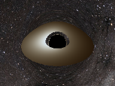
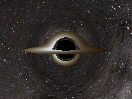
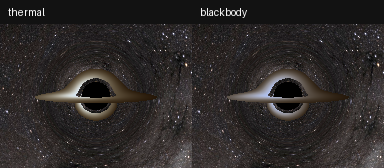
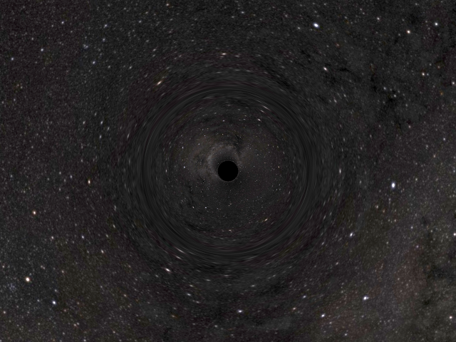
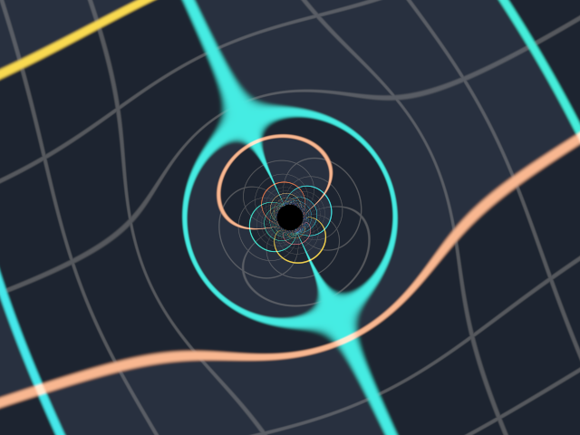

# Numerical Observatory

A small, independent CPU ray tracer for Schwarzschild and exact Kerr black-hole shadows.
It traces null geodesics toward the past from a local camera, lenses an astronomical
star map at infinity, and saves a PNG plus numerical diagnostics. No existing C++
project, CarpetX installation, GPU, CUDA, or compiler is required.

An optional opaque luminous disk supports Schwarzschild and equatorial Kerr
circular orbital motion, gravitational
redshift, Doppler beaming, and higher-order surface images. It is **disabled by
default**; existing starfield/grid configurations retain their original results.
See the [disk validation report](examples/disks/REPORT.md).

## Experimental binary KS approximation

An optional `spacetime.type = "binary_ks_approx"` superposes two fixed,
nonspinning outgoing Cartesian Kerr–Schild covariant metric terms. It uses only
the generic Hamiltonian integrator, existing static camera, celestial backgrounds
and CPU workers. **It is not an exact binary vacuum solution**: capture spheres
are provisional cutoffs, and a signature guard marks invalid-domain rays
unresolved. There is no orbital motion or binary disk support.

See the [binary guide and 96×72 configuration](examples/binary_ks_approx/README.md),
[matched starfield/grid previews](examples/binary_ks_approx/preview/comparison.png)
and [numerical validation and limitations](examples/binary_ks_approx/REPORT.md).
Schwarzschild and Kerr remain independently selectable with their previous
defaults. No specialized Schwarzschild or Carter solver activates for binary
scenes.

## Exact Kerr spacetime (shadow and celestial background)

Kerr describes an isolated stationary rotating vacuum black hole. Select it
explicitly; configurations without `[spacetime]` still use Schwarzschild.
Kerr supports an optional equatorial circular-geodesic disk (see below).
Kerr defaults to the general Hamiltonian ODE and also offers an optional
Carter-separated backend (see below), using the same multiprocessing,
starfield/grid and camera projection. Schwarzschild planar quadrature and
spherical rotational reuse never activate for Kerr; a requested quadrature
render falls back to ODE and records this choice.

```toml
[spacetime]
type = "kerr"
spin = 0.9
[camera]
radius = 30.0
inclination_degrees = 60.0
observer = "zamo"
fov_degrees = 35.0
width = 64
height = 48
```

`spin` is dimensionless a*=J/M² in [-0.99,0.99], while a=M a* is dimensional.
Positive spin points along +Z. Inclination is measured from +Z: 0° polar,
90° equatorial. Radius is the oblate Kerr coordinate in M, not Euclidean
radius. The default Kerr observer is a ZAMO at fixed r,theta with zero axial
angular momentum; it rotates relative to the coordinates. Static observers
are distinct and cannot exist inside the ergosphere. At zero spin ZAMO and
static conventions agree with the existing Schwarzschild camera. The exact
outgoing Cartesian Kerr–Schild metric has analytic derivatives and uses the
correct outer horizon r_plus=M(1+sqrt(1-a*²)) for capture.

Windows PowerShell:

```powershell
.\.venv\Scripts\python -m numerical_observatory --config examples/kerr/spin09_i60.toml --workers 10 --output output/kerr
.\.venv\Scripts\python -m numerical_observatory --config examples/kerr/spin09_i60.toml --background grid --workers 10 --output output/kerr-grid
```

Ubuntu:

```bash
.venv/bin/python -m numerical_observatory --config examples/kerr/spin09_i60.toml --workers 10 --output output/kerr
.venv/bin/python -m numerical_observatory --config examples/kerr/spin09_i60.toml --background grid --workers 10 --output output/kerr-grid
```

Six matched 64×48 preview configurations in `examples/kerr/` cover spin 0,
0.5, 0.9, -0.9 at 90°, plus 0.9 at 60° and 20°. All use r=30M, FOV=35° and
identical numerical/display settings. Override width/height/samples normally;
Kerr tracing is slower because it lacks spherical orbit reuse. `--workers 1`
remains serial; `--workers 0` uses the existing automatic selection.

```text
python -m numerical_observatory.kerr_validation --render --workers 10
python -m numerical_observatory.kerr_validation
python -m numerical_observatory.kerr_validation --figures-only
python -m pytest -q
```

The first command reproduces six small renders, repaints grids from the same
saved rays and runs numerical audits. Without `--render` only audits run;
`--figures-only` reuses saved rays without tracing. `--output` selects a separate
directory. No full-resolution Kerr batch is launched automatically.

See the [comparison](examples/kerr_validation/comparison.png),
[grid comparison](examples/kerr_validation/grid_comparison.png),
[quantitative validation report](examples/kerr_validation/REPORT.md) and
[coordinate, observer and data conventions](examples/kerr/README.md).
Analytical spherical-photon directions are projected into the actual finite
camera tetrad; distant-observer alpha/beta are not treated as finite pixels.
Independent Carter-separated equations audit trajectories and turning points.
Kerr `rays.npz` adds per-ray null/E/Lz/Q conservation errors and initial signed
(E,Lz,Q), while metadata records spin, coordinates, horizon and observer.
Source directions use Hamiltonian continuation to 100000M and the outgoing
Cartesian tangent: the remaining O(M b/R²) bending is checked separately from
integration error. Coarse raster sampling, sampled conservation bounds, finite
source truncation, CPU cost and the simplified disk model remain limits.

## Optional Carter-separated Kerr integration

Hamiltonian remains the default. Select `--integrator carter` or add:

```toml
[geodesics]
integrator = "carter"
fallback = "none"
```

This exact-Kerr specialization evolves compact radial and polar second-order
separated equations, preserving turning points without artificial sign flips.
It uses the same finite-camera initial covector, disk physics, background source
radius, spawn workers and supersampling. It cannot run with Schwarzschild or
custom metric/domain providers. The existing Schwarzschild optimizations remain
separate. Failed or uncertain trajectories are explicit unresolved rays;
optional `--carter-fallback hamiltonian` records genuine retraces and the original
failure reason. Exact-axis initialization needs that fallback. An uncertifiable
radial separatrix remains unresolved even when fallback is selected.

PowerShell:

```powershell
.\.venv\Scripts\python -m numerical_observatory --config examples/kerr_disks/configs/spin09_prograde_i85.toml --integrator carter --workers 10 --output output/kerr-carter
```

Ubuntu:

```bash
.venv/bin/python -m numerical_observatory --config examples/kerr_disks/configs/spin09_prograde_i85.toml --integrator carter --workers 10 --output output/kerr-carter
```

Use `--integrator hamiltonian` for a matched reference, a separate output
directory, and `--width 96 --height 72` for a preview. Backend provenance and
constraint-completeness flags accompany saved Carter ray data. See the
[backend guide](examples/kerr_carter/README.md),
[measurements and limitations](examples/kerr_carter/REPORT.md), and
[matched images](examples/kerr_carter/comparison.png). The specific former
seventh-crossing disagreement is resolved against independent radial/polar
quadrature; arbitrary higher-order rays still require convergence checks.

## Kerr accretion disk

Kerr disks reuse the existing opaque-surface renderer, invariant frequency-shift
calculation, bolometric g^4 transformation and unchanged display palettes.
Their geometry is fixed to the Kerr equatorial plane z=0, with no independent
disk tilt. Set the camera inclination relative to global +Z instead.

```toml
[spacetime]
type = "kerr"
spin = 0.9
[disk]
enabled = true
orbit = "prograde"
inner_radius = "isco"
outer_radius = 20.0
temperature_inner = 10000.0
temperature_index = 0.75
[disk.display]
palette = "blackbody"
exposure = 5.0
tone_mapping = "reinhard"
```

`inner_radius="isco"` is the Kerr default. A numerical inner radius in M is
also supported, but must be at or above the selected orbit's ISCO; outer radius
must exceed it. `orbit="prograde"` follows the sign of black-hole angular
momentum, while `retrograde` opposes it. Negative spin changes coordinate
rotation direction without changing the disk plane. At zero spin, prograde
means positive coordinate azimuth and retrograde means negative azimuth;
both ISCOs are 6M. The original Schwarzschild settings/defaults are unchanged.

The disk uses **Kerr r**, not sqrt(x²+y²), for boundaries and temperature. At
z=0 the Cartesian cylindrical radius is sqrt(r²+a²). Circular four-velocities
are constructed from the actual KS stationary/axial Killing vectors and
normalized using the metric. The frequency ratio contracts the actual camera
(ZAMO or configured observer) and emitter velocities with compatible photon
covectors. No extra Doppler, lensing or frame-dragging multiplier is used.
Earlier plane crossings through the hole or beyond the outer edge still count
but do not emit or terminate the physical ray. The first annulus hit is opaque.

The temperature is the existing phenomenological power law, not a
Novikov–Thorne model. Holding T_in fixed across spins does **not** hold mass
accretion rate, total luminosity, or temperature at a fixed outer radius fixed.
This matters when comparing the brightness of different ISCO configurations.

Windows PowerShell:

```powershell
.\.venv\Scripts\python -m numerical_observatory --config examples/kerr_disks/configs/spin09_prograde_i85.toml --workers 10 --output output/kerr-disk
.\.venv\Scripts\python -m numerical_observatory --config examples/kerr_disks/configs/spin09_retrograde_i85.toml --workers 10 --output output/kerr-retrograde
.\.venv\Scripts\python -m numerical_observatory.disk_diagnostics --input output/kerr-disk --output output/kerr-disk-maps
```

Ubuntu uses `.venv/bin/python` with the same arguments. The six configurations
also cover spin 0, 0.5, -0.9 and a 60° camera; the principal comparison uses 85°.
They are small 96×72 previews with r_camera=60M, FOV=60° and no supersampling.
The [preview comparison](examples/kerr_disks/comparison.png),
[physical validation report](examples/kerr_disks/REPORT.md), and
[Kerr disk guide](examples/kerr_disks/README.md) describe measurements and limits.

```text
python -m numerical_observatory.kerr_disk_validation --render --workers 10
python -m numerical_observatory.kerr_disk_validation
python -m numerical_observatory.kerr_disk_validation --figures-only
```

The first command validates and renders the previews plus an equivalent
Schwarzschild control. Without `--render` only selected numerical audits run;
`--figures-only` repaints saved rays and maps without integration. The optional
`--nearcritical-audit` records a seventh-crossing reference-precision experiment,
including its failed independent coordinate check; it is not a certificate
for arbitrarily narrow higher-order images. No validation threshold is relaxed.

Recolor saved physical data without tracing (also works for Schwarzschild):

```text
python -m numerical_observatory.surface_render --input output/kerr-disk --output output/kerr-disk-gray --palette gray --exposure 3 --background grid
```

Kerr `disk_rays.npz` retains the old status/g/intensity/hit/crossing/direction
fields and adds hit events/covectors/affine values, emitted temperature and
bolometric intensity, equatorial KS azimuth, and per-ray E/Lz/Q/null diagnostics.
Metadata records spin, relative orbit, coordinate rotation, ISCO and resolved
inner radius. Emitted azimuth is outgoing Cartesian KS atan2(y,x), zero +X,
positive toward +Y, [0,360); it is not the BL azimuth. Saved first-hit radius,
crossing-number and azimuth maps support Kerr. Kerr multilayer analysis and
Schwarzschild planar orbital-angle/alignment-ring diagnostics are explicitly
unsupported for Kerr and fail clearly rather than substitute Schwarzschild.
The targeted `diagnostic_zoom` also reconstructs Kerr disks correctly.

For deliberate full-resolution rendering, add `--width 640 --height 480` to
the ordinary render command and choose a separate output directory. This can
be expensive: Kerr uses independent trajectories in either backend, with no spherical
reuse, and internal geometry can extend beyond the first hit while physical
radiance/constraint checks stop there. No full-resolution or supersampled
Kerr disk batch is launched automatically. The disk remains a thin, stationary,
isotropic two-face test-emitter model without hydrodynamics or radiative transfer.

## Optional luminous disk (Schwarzschild)




Use `examples/disk_inclined.toml` (60°) or `examples/disk_edge_on.toml` (85°).
After the platform-specific setup below, these commands work with either
PowerShell or Ubuntu when the virtual environment is activated; alternatively
replace `python` with `.venv/Scripts/python` or `.venv/bin/python` respectively.

```text
python -m numerical_observatory --config examples/disk_inclined.toml --output output/disk
python -m numerical_observatory --config examples/disk_edge_on.toml --background grid --output output/disk-grid
python -m numerical_observatory --config examples/disk_inclined.toml --no-disk --method quadrature --output output/no-disk
python examples/render_disks.py
python -m numerical_observatory.disk_validation
python examples/validate_disk_sampling.py
python -m pytest -q
```

`render_disks.py` produces all six matched starfield/grid examples in
`examples/disks/`, including diskless controls. Defaults are 192×144 with one
ray per pixel; `--width 384 --height 288 --samples 2` increases resolution and
uses 2×2 subpixel rays. CPU rendering takes minutes at the default size.
The sampling audit renders additional low-resolution scenes and asserts
convergence of physical observables; `--measure-only` rechecks saved results.

Minimal optional configuration (the example files include all settings):

```toml
[disk]
enabled = true
inner_radius = 6.0
outer_radius = 20.0
inclination_degrees = 60.0
position_angle_degrees = 0.0
rotation = 1
temperature_inner = 10000.0
temperature_index = 0.75
emissivity_scale = 1.0

[disk.display]
exposure = 2.0
reference_temperature = 10000.0
tone_mapping = "reinhard"
palette = "thermal"
```

Radii are in M; temperature is in kelvin. The normal is
`(sin(i) sin(PA), sin(i) cos(PA), cos(i))`: inclination is relative to global
+z and equals the observer inclination for these cameras on +z. Moving or
reorienting a camera requires interpreting the angle relative to its actual
view. Rotation is +1 or -1 around that normal. Both disk faces emit identically.
Timelike circular orbits require r>3M; those below 6M are unstable. The factory
rejects an inner radius at or below 3M. This is a toy emitting surface, not a
realistic accretion-flow solution.

The physical model is `T(r)=T_inner*(r/r_inner)**(-temperature_index)` and
`I_bol,emit=emissivity_scale*sigma*T**4/pi`. Covector/four-velocity contractions
give g; observed bolometric intensity is **g⁴ I_bol,emit**. The separate spectral
function implements **g³ I_nu,emit(nu_obs/g)**, preserving I_nu/nu³. Saved
`disk_rays.npz` includes physical intensity, g, hit locations, crossing index,
and escaped directions. Status codes are 0 captured, 1 escaped, 2 unresolved,
3 emitted. RGB uses an illustrative thermal palette, exposure and tone mapping;
it is not a calibrated color observation. `palette="gray"` and
`tone_mapping="linear"` are alternatives. Starfield exposure is independent.

For CIE-based thermal color, set `palette = "blackbody"` in `[disk.display]`.
The default remains `"thermal"`; `"gray"` is also available. The blackbody palette
integrates Planck **spectral radiance per wavelength** against the standard
CIE 1931 2° color-matching functions over 360–830 nm. It uses the **observed**
temperature `g*T_emitted`, already stored by the renderer. Only chromaticity is
retained: the existing observed bolometric radiance (including g⁴), exposure,
and tone mapping supply brightness. There is no extra Doppler multiplier or
visible-flux weighting of the saved intensity.

The bundled, unmodified 1 nm CIE table comes from
[CIE 018:2019, Table 6](https://doi.org/10.25039/CIE.DS.xvudnb9b), licensed
CC BY-SA 4.0; original metadata, checksums, attribution and license links are in
`src/numerical_observatory/data/ATTRIBUTION.md`. No new dependency is required.
A lazy 4,097-entry log-temperature lookup (1,000–10,000,000 K) avoids spectral
integration per pixel. Positive temperatures outside that range use endpoint
chromaticities, without clamping physical temperature or intensity. Invalid
nonpositive/nonfinite display temperatures raise an error.

XYZ is converted to linear sRGB using a matrix derived from the
[standard sRGB primaries and D65 white point](https://registry.color.org/rgb-registry/srgb).
These are self-luminous source colors: no chromatic adaptation or per-temperature
white balancing is applied, and there is no D50 ICC profile-connection step.
In particular, a 6,504 K Planck spectrum is not assumed identical to daylight D65.
Negative out-of-gamut RGB channels are clipped to zero, then the largest channel
is normalized to one. The existing bolometric display level multiplies that
color, and final channels are clipped to [0,1] before standard sRGB encoding.
Thus the brightness control retains its existing maximum-channel convention;
it does not promise constant photopic luminance or a calibrated visible-light
flux. Gamut clipping changes chromaticity for very cool sources. Actual
appearance also depends on exposure, tone mapping, display gamut and viewing
conditions. The palette adds no artistic orange bias.

The tests compare the lookup against independent SI Planck-frequency integration
with the wavelength Jacobian and 0.25 nm Simpson quadrature: normalized XYZ agrees
within 3e-6 across the supported range, and within 2e-6 at 3,000, 5,800, 10,000
and 15,000 K. Lookup interpolation alone agrees with direct 1 nm integration
within 3e-7. These are numerical colorimetry checks, not guarantees about human
appearance.

Recolor an existing completed render without retracing or changing its files:

```text
python examples/compare_disk_palettes.py
```

This reads `examples/disks/edge_on_starfield/disk_rays.npz` and writes a labelled
comparison plus individual images to the separate `examples/blackbody_palette/`
directory. It changes only the palette; background, physical intensities,
frequency shifts, exposure and tone mapping are identical. `--source` and
`--output` select other completed ray data and a separate destination. The
script does not consult or modify the high-resolution render configuration.



Disk tracing uses the general ODE path even when `--method quadrature` is
requested; diagnostics record this fallback. Plane crossings through the inner
hole or outside the outer radius are skipped, and the first valid opaque hit
occludes everything behind it. No screen-space glow is added. Exact rotational
reuse, where allowed, reuses trajectories only: surface hits and Doppler shifts
are calculated separately for each pixel. The independent orbital-quadrature
audit checks intersections and photon momenta but is not a production disk
backend.

The added modules separate `surfaces.py` (geometry), `emitter_motion.py`
(Schwarzschild orbits), `emission.py` (radiance), `display.py` (visualization),
`disk.py` (scene assembly), and `surface_render.py` (opaque rendering).
The camera and metric-provider interfaces remain general. New spacetime models
need their own emitter motion and trace domain; they cannot silently use the
Schwarzschild-only optimizations.





The [lensing validation report](examples/validated/REPORT.md) gives measured
shadow size, ODE/quadrature convergence, winding counts, and sampling limits.
The outer arcs are physical; the finest near-shadow structure is under-resolved.
Both images above use exactly the same saved 4×4 subpixel ray directions.

The updated composition above uses a **32° horizontal field of view**, a static
camera at **400M**, and a **640×480** image. This shows a narrower sky patch than
the original 60° view from 20M, with a smaller centered shadow and a substantial
border around the strong lensing region. It uses the 8k version of the same NASA
star map. Weak gravitational deflection decreases continuously toward the edges;
there is no artificial cutoff or blend to an unlensed background.

Settings are in `examples/composition.toml`. After setup, the commands below
regenerate both backgrounds, unlensed references, a labelled grid atlas, a freshly
traced near-shadow close-up, and quantitative diagnostics in `examples/validated/`.
Historical renders remain in `examples/composition/` and `examples/rendered/`.

## Reveal hidden disk-crossing layers

The separate, opt-in `disk_layers` command traces through earlier emitting
surfaces to reveal later **plane-crossing** images. Ordinary rendering continues
to stop its radiative history at the first valid opaque hit. A crossing-2 layer
is a mathematical diagnostic, not a physical observation through an opaque disk.

Reference experiment, Windows PowerShell:

```powershell
.\.venv\Scripts\python -m numerical_observatory.disk_layers --input-render output/disk-edge-on-blackbody-hires --workers 10 --method quadrature --max-crossing 4 --crop 179 134 461 346 --output examples/disk_layer_analysis
```

Ubuntu:

```bash
.venv/bin/python -m numerical_observatory.disk_layers --input-render output/disk-edge-on-blackbody-hires --workers 10 --method quadrature --max-crossing 4 --crop 179 134 461 346 --output examples/disk_layer_analysis
```

This is new geodesic intersection calculation at the original 640×480 sampling,
not reconstruction of unrecorded events from the old first-hit file. The
Schwarzschild quadrature backend collected the reference data in about 50 s on
this computer, followed by compression/output. No large supersampled image was
launched. See the [hidden-layer report](examples/disk_layer_analysis/REPORT.md)
for the images, numerical validation and scientific conclusions.

For an independent configuration use `--config examples/disk_layers.toml`
instead of `--input-render`. This new example matches the reference physical and
numerical parameters and uses the blackbody palette. `--width` and `--height`
override dimensions; `--samples` chooses subrays per pixel axis (default matches
the input render, or one for a config). Workers use the existing spawn-safe
scheduler and exact rotational trajectory grouping.

`--target 2` is the default. `--max-crossing 4` records up to four plane crossings
in one trajectory calculation and produces crossing-1/2/3/4 images from those
records. A higher maximum is supported. Observed higher emitting ordinals and
the selected target can also be displayed; no later event substitutes for a
missing target. At crossing 2, a previous hole or outside-edge crossing still
counts as crossing 1 but does not conceal it. A previous valid material hit does
conceal it, even if that material's emissivity is zero. For target 3 or higher,
the visibility classification considers **any** earlier valid emitting hit.

Reuse the same data with no new trajectories, changing target, crop, alpha or
display palette:

```text
python -m numerical_observatory.disk_layers --reuse examples/disk_layer_analysis --target 2 --alpha 0.2 --palette gray --crop 220 170 420 315 --output output/layers-gray
python -m numerical_observatory.disk_layers --reuse examples/disk_layer_analysis --target 3 --output output/layer-three
```

Raw data are in `disk_layers.npz`, with context in `trace_metadata.json`:

- `crossings` is a structured array, ordered by ray and increasing affine
  parameter. Fields include `plane_ordinal`, `emitting_ordinal`, spacetime
  `event=(t,x,y,z)`, covariant `momentum`, `affine`, `radius_M`,
  `azimuth_degrees`, `region`, `geometry_valid`, `emission_valid`, `g`,
  `bolometric_intensity`, `observed_temperature`, `phi_radians`, and `null_error`.
- `pixel_index` identifies the row-major subray for each table row;
  `ray_offsets[i]:ray_offsets[i+1]` selects ray i's records. A plane hit in the
  central hole has region 1, material annulus 2, and beyond the outer edge 3.
  Region 0 means invalid. Nonemitting records retain radius, event, momentum and
  plane ordinal; they have no valid emitting ordinal or emission frequency.
- `ray_status`, `ray_reason`, `ray_null_error`, `directions`,
  `crossing_limit_reached` and `backend` describe the transparent trajectory and
  numerical/recording limits. Status counts describe full geometry, not physical
  opaque visibility. Directions are mathematical background continuations.
- Phi is the nonnegative unwrapped orbital angle to the selected crossing,
  when recoverable; it is not disk azimuth. ODE angles are unavailable if the
  dense-angle unwrap fails its step check. Missing emission values use NaN or
  zero intensity together with explicit validity flags.

`views/` contains the original opaque reference (when available), the independently
reconstructed first-hit image, each `crossing_N.png`, a crossing-1 foreground
outline over the selected layer, the adjustable composite, visibility and
intersection-region maps, emission-radius and cyclic azimuth maps, a valid-hit
mask, matching crops and a six-panel comparison atlas. Black in a layer image
means no valid emitting hit at that ordinal, **not necessarily capture**.
Scientific map color bars and legends are separate from display exposure.
`target_arrays.npz` and `crops/target_arrays.npz` expose values, masks, plane-hit
region and presence, emitting ordinal and source crop bounds. Crop enlargement
is nearest neighbor and adds no new angular information.

The composite overlays the separately tone-mapped, display-linear crossing-1
image with alpha 0.35 by default over the selected layer. This alpha blend is
not attenuation, radiative transfer or a physical sum of emitted fluxes. Each
individual event uses the unchanged emitter velocity, g, g^4 bolometric intensity,
temperature law and display pipeline. Other layers remain independent images.

`--method auto` uses exact Schwarzschild radial quadrature only for a centered
static camera outside the annulus. It uses the existing orbital-angle turning
point quadratures to locate successive plane roots, reconstruct full events and
momenta, and apply the configured capture/escape/affine limits. Critical or
numerically unsuitable cases fall back to ODE. `--method ode` uses the original
Hamiltonian tracer and existing dense plane-root detector on a full trajectory.
It is useful for validation and general camera configurations. Both methods
keep distinct radii grouped across workers, evaluate each pixel's own tilted
disk intersections and retain all requested layers in one pass. Quad constraint
diagnostics test reconstructed states; they are not claimed as ODE trajectory
residuals. The ODE cache still follows its natural endpoint for constraint checks
and reuse, while stored crossings are capped at the requested maximum.

Quick native-sampling window, preserving the original pixel-to-ray projection:

```text
python -m numerical_observatory.disk_layers --input-render output/disk-edge-on-blackbody-hires --window 248 236 392 266 --workers 5 --crop 0 0 144 30 --output output/layer-window
```

`--density N` with `--window` explicitly requests genuinely denser angular
sampling; it is never automatic. Window metadata stores virtual full-camera
dimensions and pixel origins. View crop bounds then refer to the local window
image. `--features` selects earlier region masks for continuity analysis; the
reference masks are used only when their visible-layer samples agree.

The reference result has **4,668 crossing-2 emitting pixels: 4,108 normally
visible and 560 formerly concealed**. They match the old opaque classification
exactly. A 4,592-pixel component connects both branch bases and the lower crescent,
but 24 smaller upper-halo raster components remain. Extra subpixel ray probes
confirm emission between some missed pixel rows. The report distinguishes this
raster result from source-map continuity and image-family interpretation.
`views/continuity.json` and `continuity_arrays.npz` record component labels,
unchanged feature masks, sampled bridge paths and circular source-coordinate
differences; no morphological filling is applied.

An explicit small independent audit is reproducible with
`python examples/validate_disk_layers.py`. It compares stored quadrature states
against the existing ODE at original and tighter validation tolerances, including
later emitting hits. It does not repeat the full image integration. The normal
opaque renderer and its saved format are unchanged.

## Scientific disk-hit diagnostic maps

Generate maps directly from a completed render with no tracing:

```powershell
.\.venv\Scripts\python -m numerical_observatory.disk_diagnostics --input output/disk-edge-on-blackbody-hires --output examples/disk_diagnostics
```

Ubuntu:

```bash
.venv/bin/python -m numerical_observatory.disk_diagnostics --input output/disk-edge-on-blackbody-hires --output examples/disk_diagnostics
```

Use `--input` for a different completed render, including the exposure-5 version.
Use `--output` for a separate diagnostics directory. For a custom native-image
crop and enlargement, append `--crop 220 170 420 315 --scale 4`. Bounds are
`x0 y0 x1 y1`, with x1/y1 exclusive; x is column from the left and y is row from
the top. Every map and visible-image crop uses the exact same bounds. The default
central 44% crop for 640×480 is **[179,134,461,346)**: 282×212 original pixels,
enlarged to 1128×848 with nearest neighbor. This adds no ray-tracing resolution.

The new [diagnostic report](examples/disk_diagnostics/REPORT.md) examines the
narrow halo and branches using the saved 640×480 blackbody render. The output
contains:

- `emission_radius.png`: annotated first-hit Schwarzschild radius r_emit/M,
  with a continuous sequential color bar (6–20M for this disk).
- `crossing_number.png`: categorical ordinal of the plane crossing that first
  reaches the emitting annulus. Earlier crossings through the hole or beyond
  the outer edge still count. This is not a winding number or assigned image
  order.
- `emission_azimuth.png`: cyclic first-hit azimuth, in degrees [0,360), with a
  matching 0°/360° color boundary.
- `crops/`: matching decorated and plain crops of all three maps and the exact
  saved `shadow.png`; `crop_comparison.png` presents the four crops together.
- `*_pixels.png`: plain scientific rasters without labels or margins; annotated
  versions place that raster at offset (20,55), recorded in metadata.
- `diagnostic_arrays.npz`: `radius_m`, `crossing_number`, `azimuth_degrees`,
  `status`, `emitted`, per-field `*_valid` masks, `samples`, `mass`, and crop
  bounds. Invalid continuous values are NaN. Zero is a missing sentinel for
  crossing number and must be read with `crossing_valid`. A matching cropped
  archive is also saved as `crops/diagnostic_arrays.npz`.
- `metadata.json`: source checksums, coordinate conventions, crop bounds,
  enlargement, validity counts and missing-field warnings.

The scientific values do not use temperature, g, intensity, exposure, blackbody
colors or tone mapping. Black is capture, blue-gray is escaping background,
magenta hatch is unresolved, and gray hatch marks a missing/invalid diagnostic
on an emitting ray. Unknown status codes are gray. The radius comes from the
actual first opaque intersection, not the photon's closest approach or an
image-plane distance. All three maps preserve the first-valid-hit semantics.

Azimuth uses the saved Cartesian Kerr–Schild emitting position and disk normal n.
Its zero vector e0 is global +X projected onto the disk plane and normalized;
if that projection vanishes, global +Y is used. Define e90=n cross e0 and
phi=atan2(position dot e90, position dot e0), wrapped into [0°,360°). Increasing
phi follows the right-hand rule around n, matching positive disk rotation.
For the 85° example, e0=(1,0,0), e90=(0,0.087156,-0.996195); the camera is on
+Z. Thus phi=90° lies on the far side and 270° on the near side. Other camera
orientations do not redefine these disk coordinates. The projection fallback
is a coordinate-chart convention near a normal parallel to +X/-X.

Older files work when they contain `status`, positive metadata `mass`, and the
relevant hit fields. Radius uses `hit_radius`, falling back to norm(hit_position)
when the radius field is absent. Azimuth requires `hit_position` and
`geometry.normal`; crossing number requires `crossing_index`. Missing fields
produce explicit unavailable masks and warnings rather than inferred values or
retracing. Radius color limits use the saved disk boundaries, otherwise the
observed finite range. Grid companion renders can follow `ray_data_source`;
`--rays path/to/disk_rays.npz` overrides a moved/older reference.

Supersampled files retain every subray in the numerical arrays and scientific
rasters (width*samples by height*samples). Categories and angles are never
averaged. Crop coordinates still refer to the original output image and are
multiplied by samples consistently. For comparison, the already averaged visible
image is repeated onto the subray grid; this does not recover its individual
subray display values. `--scale` enlarges that grid. The 640×480 diagnostic
example uses one ray per pixel, so all four rasters align directly.

Optional genuinely denser angular sampling is available separately:

```powershell
.\.venv\Scripts\python -m numerical_observatory.diagnostic_zoom --input output/disk-edge-on-blackbody-hires --output output/disk-shadow-new-rays --crop 260 184 380 300 --density 2
```

On Ubuntu use `.venv/bin/python` for the same module and arguments. This explicit
command **launches new geodesics** and can be expensive; it is never invoked by
postprocessing. Density 2 samples a 240×232 window of the original virtual
1280×960 camera. It preserves the original camera event, orientation, 60° full
FOV, source-pixel region and all numerical settings. It does not recenter or
change FOV. The helper deliberately uses the existing serial ODE path with
symmetry disabled, since the ordinary symmetry/multiprocessing pixel generators
assume full frames. New results have the same disk-ray fields and can be passed
to `disk_diagnostics`; window-to-source coordinates are recorded in their JSON.
No optional zoom tracing was run for the supplied diagnostics.

## Accumulated orbital angle and celestial alignment rings

The closely related postprocessor `orbital_diagnostics` measures the Schwarzschild
orbital angle separately from the disk emission azimuth. It reads the same saved
camera and first-hit positions, reconstructs the actual initial covectors and
conserved E,L, and uses the existing validated orbital quadrature. The 640×480
maps require no image-geodesic reintegration or new ray-data fields.

PowerShell:

```powershell
.\.venv\Scripts\python -m numerical_observatory.orbital_diagnostics --input output/disk-edge-on-blackbody-hires --features examples/disk_diagnostics --output examples/orbital_diagnostics
```

Ubuntu:

```bash
.venv/bin/python -m numerical_observatory.orbital_diagnostics --input output/disk-edge-on-blackbody-hires --features examples/disk_diagnostics --output examples/orbital_diagnostics
```

The default crop remains x=[179,461), y=[134,346). `--crop X0 Y0 X1 Y1` and
`--scale 4` customize it using the same half-open native-image coordinates as
the disk-hit diagnostics. `--features` reads existing feature masks without
modifying them; their source fields must agree. Use `--no-features` for maps
without the example-specific region statistics. Output must be separate from
the source render and previous diagnostic products.

Files include `phi_emit.png`, `phi_background.png`, visible-light and crossing-map
ring overlays, matching `crops/`, `crop_comparison.png`, `orbital_angles.npz`,
`alignment_rings.json`, `feature_statistics.json`, and provenance metadata.
Each annotated PNG has a plain `*_pixels.png` counterpart. Numerical archives
save radians and angle/pi, validity masks, source/continuation statuses, emission
radial leg, endpoint geometry-check residuals, native image radii, and masks
separating physically visible background from hypothetical transparent-disk
continuations. A cropped archive is saved too. Missing continuous angles are NaN.

Phi starts at zero at the camera and increases along the past-directed ray,
with dPhi/dlambda=|L|/r². It is nonnegative and never reduced modulo 2pi. The
orbital-plane basis is formed from the camera radial vector and the conserved
angular-momentum direction; it is not the disk's azimuth basis. In this outgoing
Kerr–Schild implementation r=norm(x), the angular part of the metric is r²dOmega²,
and conversion to standard Schwarzschild coordinates changes time only. Hence
the unwrapped position angle in that fixed plane is precisely the Schwarzschild
orbital angle; this reasoning does not generalize automatically to Kerr or
arbitrary numerical Cartesian coordinates.

`Phi_emit` stops at the saved first opaque emitting intersection. The inbound
and outbound radial quadratures are compared against the actual saved position
in the conserved orbital plane; neither crossing number nor disk azimuth is
used to select the angle. `Phi_background` runs to **infinity**, including the
same analytic tail beyond the finite ODE escape sphere used by the celestial
renderer. Its values on disk-emitting pixels are explicitly **hypothetical
transparent-disk continuations**. They do not represent light transmitted
through an opaque surface. Captured continuations have no background angle.

For this 60M, 60°, 640×480 camera, the critical radius is 47.365231 pixels and
the independently solved infinity-angle pi/2pi/3pi rings are at 160.842895,
48.709245 and 47.420172 pixels. Thus the 2pi ring is **1.344014 pixels** outside
the critical curve. These are finite-camera roots with the original pinhole
projection, not rescaled radii from the 400M camera. Orders 4 and 5 are tabulated
in JSON; no rings are artificially separated for display. The 3pi ring is only
0.054941 pixels outside the critical curve and is visually unresolved here.

The [orbital-angle report](examples/orbital_diagnostics/REPORT.md) provides all
root convergence, feature statistics, validation and interpretation. The upper
halo samples Phi_emit/pi=1.853–1.972, while the two branches span 1.339–1.932.
Their transparent background angles vary across the 2pi ring: this is a related
disk-image layer, not an isocontour of constant background angle.

For an explicit small independent audit, append `--validate-ode`. This runs 15
representative rays at two tolerances (30 ODE integrations, about 12 seconds
on this computer), rather than rerendering the image. It compares radial
quadrature against both unwrapped dense-ODE position geometry and integrated
angular velocity, plus the existing infinity tail. Normal map reconstruction
took about 17 seconds for 28,772 distinct conserved orbits; cost depends on
resolution. Production rendering algorithms, physical parameters and numerical
tolerances are untouched.

Current saved-data maps require a centered coordinate-static Schwarzschild
camera (including the documented diagnostic-window mapping). Positive photon
energy, finite hit positions and the original camera parameters are required;
hit momentum need not be stored. If a spatial self-intersection makes both
radial legs consistent with the saved point, the emission angle is explicitly
marked unavailable. Exactly critical continuations are unresolved. Pure radial
motion has zero accumulated angle and no unique orbital plane; nearly radial
angles use their small conserved L without forcing them to zero. Unsupported
cameras or invalid data do not trigger an automatic expensive ODE rerun.

For new angular information, use the separately documented `diagnostic_zoom`
helper explicitly. Density 8–16 is a useful next step for thin halo/branch
segments; it does not resolve a 0.055-native-pixel ring separation well. That
separation would require roughly 64 samples per original pixel width to span
three new pixels, so use a very small targeted region and account for the
helper's serial cost. No expensive targeted render was launched here.

## Parallel CPU rendering

`--workers 1` retains serial rendering and is the default. `--workers N` enables
up to N spawned processes for N>1. `--workers 0` selects available physical CPU
cores when Windows topology or Linux sysfs can identify them, intersecting the
result with process CPU affinity. If physical topology is unavailable, it uses
half the available logical CPUs, rounded up (at least one). Here it detects
10 physical cores and 20 logical CPUs, so automatic selection is 10. Containers
with CPU quotas that do not restrict affinity may require an explicit count.
For very small workloads the pool is capped to the number of work batches;
diagnostics record both requested and selected pool sizes. Windows allows at
most 61 workers. Negative counts are errors.

Windows PowerShell (after setup):

```powershell
.\.venv\Scripts\python -m numerical_observatory --config examples/disk_edge_on.toml --workers 0 --output output/disk-edge-on-auto
.\.venv\Scripts\python -m numerical_observatory --config examples/disk_edge_on.toml --workers 5 --samples 2 --background grid --output output/disk-grid-parallel
```

Ubuntu:

```bash
.venv/bin/python -m numerical_observatory --config examples/disk_edge_on.toml --workers 0 --output output/disk-edge-on-auto
.venv/bin/python -m numerical_observatory --config examples/disk_edge_on.toml --workers 5 --samples 2 --background grid --output output/disk-grid-parallel
```

Spawn is used on both platforms. Python callers must put rendering inside
`if __name__ == "__main__":`; metric, surface and custom domain objects must be
pickleable, with functions/classes defined at module scope. The normal CLI
already handles this. An explicitly supplied dense `path_cache` remains a
serial-only API; parallel rendering creates its own exact orbit tasks.

Tasks are dynamically scheduled, with at most twice the worker count in flight.
General ODE views use 64-pixel linear tiles. Centered Schwarzschild views group
all pixels with the same image-plane radius, batching four distinct radii per
task. Each representative trajectory is integrated exactly once across the
whole pool; every disk ray still evaluates its own rotated trajectory, surface
crossings and emitter state. Quadrature groups sixteen escaping orbits per
task. There is no trajectory interpolation or change to integration tolerances.
The parent assembles results by pixel coordinates, shades the sky/disk with
the original display code and averages subpixels in the original order.

Worker scenes initialize once; large star textures and final image arrays live
only in the parent. Dense trajectories stay within their worker and are released
between batches. Small ray results cross process boundaries. NumPy/BLAS thread
counts are set to one in spawned workers to avoid multiplying process parallelism
by library thread parallelism; the parent's environment is restored afterward.
Each process still incurs Python/NumPy/SciPy memory and startup costs. Small
quadrature renders can be much faster with one worker. Parent-side display,
assembly, compression, communication and serial work limit total speedup.
Hyper-Threading shares physical core resources: 20 workers need benchmarking
against 5 and 10, rather than an assumed 2× gain. On this 10-core/20-thread
Windows computer, **10 workers is the measured recommendation**. The 128×96
disk benchmark took 145.95 s serially, 33.33 s with 5 workers, 23.04 s with 10,
and 24.41 s with 20. Three-run medians confirmed 10 (22.37 s) ahead of 20
(24.04 s): approximately 6.5× the serial speed on this workload. Ten workers also
won the supersampled and background ODE comparisons. The small quadrature
background was fastest serially. See the [benchmark report](examples/parallel_benchmark/REPORT.md)
for efficiency, memory, startup measurements and exact output comparisons.

Recommended 640×480 nearly edge-on command (the full-size runtime has not been
remeasured, so the small-scene speedup is not a promised completion time):

```powershell
.\.venv\Scripts\python -m numerical_observatory --config examples/disk_edge_on.toml --width 640 --height 480 --workers 10 --output output/disk-edge-on-parallel
```

Ubuntu equivalent:

```bash
.venv/bin/python -m numerical_observatory --config examples/disk_edge_on.toml --width 640 --height 480 --workers 10 --output output/disk-edge-on-parallel
```

Progress reports completed rows, elapsed wall time and estimated remaining time.
When exact orbit groups finish out of row order, batch/work-unit updates keep
the indicator active. Estimates use observed throughput and can shift near
expensive critical trajectories. Updates are throttled to roughly five seconds.
Disk rays, supersampling, both backgrounds and all palettes work with workers.

Worker errors and unexpected exits propagate to the caller; Ctrl+C terminates
and joins this render's workers. Completed images/ray files/diagnostics are staged
in a temporary sibling directory and published after successful rendering.
Interrupted or failed computations leave previous output files intact. Temporary
staging needs additional disk space comparable to the output. Numerical counts,
constraint diagnostics, integration work and saved arrays remain available;
an additional `execution` object records process, startup, CPU-time and memory
measurements. Execution-specific fields and wall-clock timing can differ.

Run the controlled benchmark and inspect its report:

```text
python examples/benchmark_parallel.py --repeat-selection
```

It compares 1, 5, 10 and 20 workers with fresh processes, fixed scene parameters
and tolerances, plus an empty-message startup/communication baseline. Outputs
are isolated in `examples/parallel_benchmark/`; `--resume` retains completed
measurements. The regular tests use exact array/image comparisons, check
integration counts to catch duplicated symmetry work, and exercise worker
failures, abrupt exits, spawn startup and interruption cleanup.

## Setup and execution

Requires Python 3.11 or newer. Run commands from this project directory.
NumPy and SciPy use their standard platform wheels; this project contains no
compiled extensions. Pillow writes PNGs; pytest is used only for testing.

Windows PowerShell:

```powershell
py -3 -m venv .venv
.\.venv\Scripts\python -m pip install -e ".[test]"
.\.venv\Scripts\python -m numerical_observatory --config examples/default.toml --output output
.\.venv\Scripts\python -m pytest -q
.\.venv\Scripts\python -m numerical_observatory.validation --output output/validation.json
.\.venv\Scripts\python -m numerical_observatory.lensing_validation
```

Ubuntu (install `python3-venv` with the system package manager if unavailable):

```bash
python3 -m venv .venv
.venv/bin/python -m pip install -e '.[test]'
.venv/bin/python -m numerical_observatory --config examples/default.toml --output output
.venv/bin/python -m pytest -q
.venv/bin/python -m numerical_observatory.validation --output output/validation.json
.venv/bin/python -m numerical_observatory.lensing_validation
```

After activating the environment, `numerical-observatory` is also an installed
command. No configuration is required: defaults match `examples/default.toml`.
For a quick preview, append `--width 96 --height 72`. The default is 320×240 with
one ray per pixel. Centered Schwarzschild views reuse exactly equivalent orbits
by rotational symmetry, without interpolating between rays. Every distinct
image-plane radius still uses the full ODE solver. Other views trace every ray.
Rendering can take several minutes; the star map is bundled for offline use.
The supplied 320×240 example took 375 seconds: 15,584 pixels were captured,
61,216 escaped, and none were unresolved. The maximum sampled normalized null
residual was 2.91×10⁻⁷. Its captured-pixel mask agrees with the analytic
finite-distance shadow at every pixel center.

To reproduce the checked-in artifacts, use `--output examples/rendered` for the
renderer and `--output examples/rendered/validation.json` for the validation module.
The renderer writes `shadow.png`, `diagnostics.json`, and `rays.npz`, replacing those names in
the chosen output directory. The JSON records actual configuration, dependency
versions, counts, integration work, elapsed time, and worst sampled residuals.
Work counts and constraint maxima refer to the explicitly integrated representative
orbits; capture/escape counts refer to all image pixels. `rays.npz` contains
`directions` (height×width×3 source unit vectors) and `status` (0 captured,
1 escaped, 2 unresolved). Non-escaping directions are NaN. This allows another
background or display exposure to be applied without integrating again.

## Select a background or integration method

Set `[background] mode = "starfield"` or `mode = "grid"` in TOML, or use the
CLI override. For example, after activating the virtual environment:

```bash
python -m numerical_observatory --config examples/composition.toml --method quadrature --samples 4 --background starfield --output output/starfield
python -m numerical_observatory --config examples/composition.toml --method quadrature --samples 4 --background grid --output output/grid
```

`--method ode` is the default and uses SciPy's full Hamiltonian integrator.
`--method quadrature` is optional and restricted to compatible Schwarzschild
views; other metrics/cameras fall back to ODE. `--samples N` traces N×N subpixel
rays per output pixel with either method and averages in linear RGB. Saved ray
maps then have N times the output width and height; counts are subpixel rays.
No interpolation between photon directions is used. Supersampling reduces
aliasing but cannot resolve arbitrarily thin higher-order images.

The grid's cool cyan/blue meridians and warm red/gold parallels are spaced by
`spacing_degrees` (default 15), with minor lines at one-third that interval.
`line_width_degrees` (default 0.25) sets a fixed angular width on the sky.
Sky orientation is shared with the starfield. Starfield-only settings
`exposure` and `resolution` are ignored in grid mode; grid-only spacing/width
are ignored in starfield mode. Grid colors are diagnostic, not disk emission.

## Configuration and units

We use signature (−+++) and geometrized units G=c=1. The mass parameter is the
length GM_physical/c². In TOML, camera positions, target, time, capture/escape
radii, affine budget, and maximum step are expressed in multiples of M; the
loader scales them by `mass`. The Python API instead takes coordinates and
integration lengths directly in geometrized units. Absolute tolerance is a
single numeric tolerance on all eight state components; it is not mass-scaled.

The camera is static, outside r=2M. `target` specifies the forward orientation,
and `up` sets its roll. These Cartesian directions label axes in the local
orthonormal frame, not coordinate velocities. FOV is horizontal; aspect ratio
sets the vertical extent of the pinhole image plane. Pixel centers are sampled.
`rtol`, `atol`, `max_step`, and `max_affine` control integration. The default
escape radius is 100M; it must exceed both the camera radius and 3M.
Capture occurs at 1.99M, just inside the horizon.

The `[background]` section controls `longitude_degrees`, `latitude_degrees`,
`roll_degrees`, `exposure`, and `resolution` (4 or 8 kilopixels). The first three rotate the astronomical sky
independently of the camera. For a camera looking along −z, its unlensed center
points to the configured galactic longitude/latitude; roll rotates the surrounding
sky. Exposure multiplies decoded linear RGB before display clipping and sRGB
encoding. It is a visual exposure, not a physical luminosity measurement.

## Physics and numerical method

`metric.py` evaluates outgoing Cartesian Kerr–Schild coordinates:

```text
r = |x|, n = x/r, f = 2M/r
g_ab = eta_ab + f l_a l_b,      l_a = (1, -n)
g^ab = eta^ab - f k^a k^b,     k^a = (-1, -n)
```

This chart is regular through the **past** horizon, appropriate for inward
past-directed integration. It is the time reverse of the more usual ingoing
Kerr–Schild chart. Capture labels the shadow of an ideal black hole with no
light emerging from the horizon; the eternal vacuum solution's white-hole
region is not an emission source in this model.

For the static observer, u=(1/sqrt(1−f),0,0,0). A local spatial vector d maps to
the spacetime vector (−f(n·d)/sqrt(1−f), d+(sqrt(1−f)−1)(n·d)n).
The camera launches k=−u+e(d) with |d|=1, then lowers its index to obtain p.
Thus each photon starts past-directed and null, with unit local energy.

SciPy `solve_ivp` with DOP853 evolves Hamilton's equations with increasing
past-directed affine parameter:

```text
H = 1/2 g^ab p_a p_b = 0
dx^a/dlambda = g^ab p_b
dp_a/dlambda = -1/2 (partial_a g^bc) p_b p_c
```

Analytic metric derivatives avoid finite-difference noise. The integration
does not project momentum back onto the null cone or renormalize it. Null
residual |g^ab p_a p_b|/p_t(initial)² is monitored at accepted steps and dense
output midpoints. This is a sampled diagnostic, not a bound everywhere along
the curve. Energy p_t and the Cartesian angular momentum vector are monitored
as independent stationary/spherical-symmetry diagnostics.
These conservation diagnostics apply only to the Schwarzschild implementation;
other metrics report them as unavailable rather than assuming symmetries.

An inward crossing of the capture sphere classifies a ray as captured. An
outward crossing of the escape sphere classifies it as escaped. Because the
escape sphere lies outside the photon sphere, an exact outward null orbit
there reaches infinity. Solver failure, exhausted affine budget, or a null
residual exceeding `null_tolerance` instead produce an unresolved ray, shown
in magenta. Captured rays are black.
For inward Schwarzschild rays near the critical impact parameter, sampled
impact drift and the null residual also set an empirical reliability margin.
An uncertain outcome becomes unresolved even when the ordinary null threshold
passes. The audit retains raw outcomes to show when a coarse solver would have
misclassified a ray. Tighten tolerances and check convergence in this regime.

For escaped rays we integrate the remaining orbital angle analytically by
one-dimensional quadrature, using b=|L|/|p_t| and u=1/r:

```text
delta_phi = integral_0^(1/R) b / sqrt(1-b²u²+2Mb²u³) du.
```

Rotating the escape position's radial unit vector in its conserved orbital
plane by this angle gives the source direction at infinity. This is the
direction *toward* the source, opposite to arriving light propagation.
No finite-radius tangent approximation is used.

The background is NASA's catalog-based
[Deep Star Maps (2012)](https://svs.gsfc.nasa.gov/3895/), containing measured
stellar positions, brightnesses, and colors. Credit: **NASA/Goddard Space Flight
Center Scientific Visualization Studio**. The unmodified 4096×2048 galactic
JPEG is bundled; see [asset attribution](src/numerical_observatory/data/ATTRIBUTION.md).
It is an astronomical catalog visualization, not a telescope photograph.

Escaping source directions sample the spherical map with bilinear interpolation
in linear RGB and periodic longitude wrapping. Distorted and repeated stellar
images, together with the bent Milky Way background, show gravitational lensing.
In starfield mode the shadow is black. There are no grid lines, orange equator, artificial glow,
or accretion disk. Any bright structures are lensed background light. This is
illustrative RGB rendering without spectral/redshift transfer, scattering, or
time variability. One ray per pixel and finite texture resolution can alias
small stars and fine photon rings; this is not calibrated stellar photometry.

## Validation

For a static observer at r>3M looking toward the center,

```text
b_crit = 3 sqrt(3) M
alpha_shadow = asin(b_crit sqrt(1−2M/r) / r).
```

The factor sqrt(1−2M/r) accounts for finite observer distance. A centered
pinhole camera has shadow radius in pixels
`width/2 * tan(alpha_shadow)/tan(horizontal_fov/2)`.
The impact parameter itself is not an angular or pixel radius. See the
[Perlick–Tsupko review](https://arxiv.org/abs/2105.07101) for analytical shadow
geometry and finite-distance observers.

Tests check metric inversion and derivatives across the horizon, tetrad
orthonormality and initial nullness, radial rays, termination and rejection,
mass scaling, and rendering output. They locate the capture/escape boundary
by angular bisection at r=8M, 20M, and 50M; the recovered critical impact
parameter must agree to relative error below 3×10⁻⁷. This boundary test is
independent of the coarse image pixel grid.

Convergence tests tighten (rtol,atol) from (10⁻⁶,10⁻⁸) through
(10⁻⁹,10⁻¹¹) to (10⁻¹²,10⁻¹⁴), including a ray near the critical boundary.
An independent turning-point quadrature of the Schwarzschild orbital equation
checks the escaping directions, including bending orientation. Another test
changes the escape sphere to verify the continuation to infinity.
`validation.json` records boundary brackets and convergence against independent
orbit quadrature. Exactly critical rays have arbitrarily long dwell times near
r=3M and may be unresolved under a finite affine budget.

The supplied validation run recovered b_crit to within 4.8×10⁻⁸ relative error
at all three camera radii. Its near-critical ray gave:

| Relative tolerance | Direction error vs. orbit quadrature (unit-vector norm) | Maximum sampled null residual |
| --- | --- | --- |
| 10⁻⁶ | 1.18×10⁻⁵ | 4.06×10⁻⁶ |
| 10⁻⁹ | 8.05×10⁻⁹ | 5.08×10⁻⁹ |
| 10⁻¹² | 1.27×10⁻¹¹ | 7.26×10⁻¹² |

The expanded automated tests cover sky seam/pole handling,
saved ray maps, and rotational reuse compared with direct ODE integration
for both axis-aligned and arbitrarily positioned centered cameras. Run
`render(..., use_symmetry=False)` through the Python API to force direct tracing.
They also cover general-metric frames, ODE fallback, time-dependent energy,
numerical-domain exit, near-critical rejection, and multi-winding convergence.
Tests and CLI smoke renders run on Windows with Python 3.13.
The Ubuntu commands use the same portable Python source;
an Ubuntu runtime was not available for an execution check. In restricted
environments where pytest cannot write to the system temporary directory,
use `python -m pytest -q --basetemp .tmp/pytest-run` (pytest clears that chosen
temporary test directory).

## Architecture and extension

| Module | Responsibility |
| --- | --- |
| `metric.py` | Four-dimensional event-based metric and all four inverse-metric derivatives |
| `geodesic.py` | Generic Hamiltonian RHS, SciPy integration, domain events and constraint diagnostics |
| `kerr.py` | Exact outgoing Kerr–Schild metric, analytic derivatives, ZAMOs and Kerr invariants |
| `kerr_support.py` | Kerr horizon/escape policy and numerical asymptotic background continuation |
| `kerr_carter.py` | Optional exact-Kerr compact separated backend and audited momentum reconstruction |
| `kerr_carter_quadrature.py` / `carter_validation.py` | Independent phase quadrature, seventh-crossing audit, shadow shooting and paired benchmarks |
| `kerr_reference.py` / `kerr_validation.py` | Independent Carter equations, finite-camera analytical shadows, convergence and example comparisons |
| `camera.py` | Camera geometry, metric-based rest-space tetrad or supplied observer frame |
| `background.py` | Direction-to-RGB emission model |
| `symmetry.py` | Exact rotational reuse for centered Schwarzschild views |
| `schwarzschild_orbit.py` | Guarded optional orbit quadrature and subpixel ray maps |
| `diagnostic_render.py` | Shared-ray background comparisons and sampling |
| `render.py` | Pixel loop, statistics and file output |
| `cli.py` | Minimal TOML configuration and CLI |
| `validation.py` | Reproducible boundary and convergence diagnostics |
| `lensing_validation.py` | Systematic trajectory/winding checks, shadow sweep, matched renders |

The metric contract always receives (t,x,y,z), even though the analytic metrics are
stationary. The RHS includes the time derivative and can evolve p_t for a
time-dependent metric. The camera's default observer follows coordinate time
where it is timelike. It uses the positive-definite rest-space metric
`h_ij = g_ij - g_0i g_0j/g_00` and its symmetric inverse square root; this
reproduces the old Schwarzschild frame. A supplied `observer_frame` handles
moving observers and regions where a coordinate-static observer is impossible.
The supplied frame must be orthonormal and future-directed. Kerr configuration
selects the ZAMO observer instead of the default coordinate-static observer.

Metrics other than the exact Schwarzschild and Kerr implementations must
supply a `TraceDomain` with capture/escape level
sets and a source-direction mapping in the background's sky frame. An optional
valid-data level set terminates unavailable numerical data as unresolved. No
generic metric is presumed spherical or asymptotically flat. The exact
Schwarzschild implementation supplies its spherical horizon policy and analytical
continuation to infinity; Kerr supplies its oblate horizon policy, E/Lz/Q checks
and numerical far-field continuation. Quadrature and
rotational reuse require this exact type, a centered coordinate-static camera,
and no custom domain; subclasses cannot silently inherit these optimizations.
Low-level quadrature rejects incompatible inputs; the renderer selects ODE.
Future CarpetX support
should read saved spacetime fields, interpolate their values/derivatives at
events, and enforce data-domain boundaries. It should not import or require
the CarpetX simulation software. No such loader is implemented here.

Ray generation, integration, and output are separate so optional future batch
CPU/GPU backends can replace the serial loop without changing the observing
model. No acceleration framework or complex configuration system is included.
