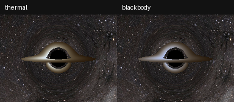

# Disk palette comparison



Left: existing three-wavelength `thermal`. Right: CIE 1931 `blackbody`.
Both use identical saved rays, g*T temperatures, bolometric intensities,
background, exposure and tone mapping. No geodesics were retraced. The source
render and its configuration were not modified. The thermal repaint matches
the source PNG exactly, including quantization.

Reproduce from the project root after installation:

```text
python examples/compare_disk_palettes.py
python -m pytest -q
```

The full suite passes **58 tests**. [Color diagnostics](color_validation.json)
compare normalized XYZ against an independent 0.25 nm Simpson integration of
Planck B_nu with its wavelength Jacobian and linearly interpolated CIE CMFs.
Maximum discrepancy is 2.08e-6 across 257 temperatures from 1,000 to 10,000,000 K;
lookup interpolation alone contributes at most 6.23e-8 in that audit. These
are numerical checks, not measurements of a real display or human perception.

The palette uses D65 sRGB primaries without per-source white adaptation, clips
negative RGB channels and normalizes the largest channel to one. Physical
bolometric intensity controls the existing display level. Cool out-of-gamut
colors and final clipping limit fidelity; exposure, tone mapping and viewing
conditions also affect appearance. Outside the lookup range only chromaticity
is clamped. See the root README for the complete convention.

CIE 2019 CMFs, DOI [10.25039/CIE.DS.xvudnb9b](https://doi.org/10.25039/CIE.DS.xvudnb9b),
are bundled unmodified under CC BY-SA 4.0; attribution and original metadata
are in `src/numerical_observatory/data/`. The comparison's astronomical
background credits NASA/Goddard Space Flight Center Scientific Visualization
Studio, as documented in the project's attribution file.
