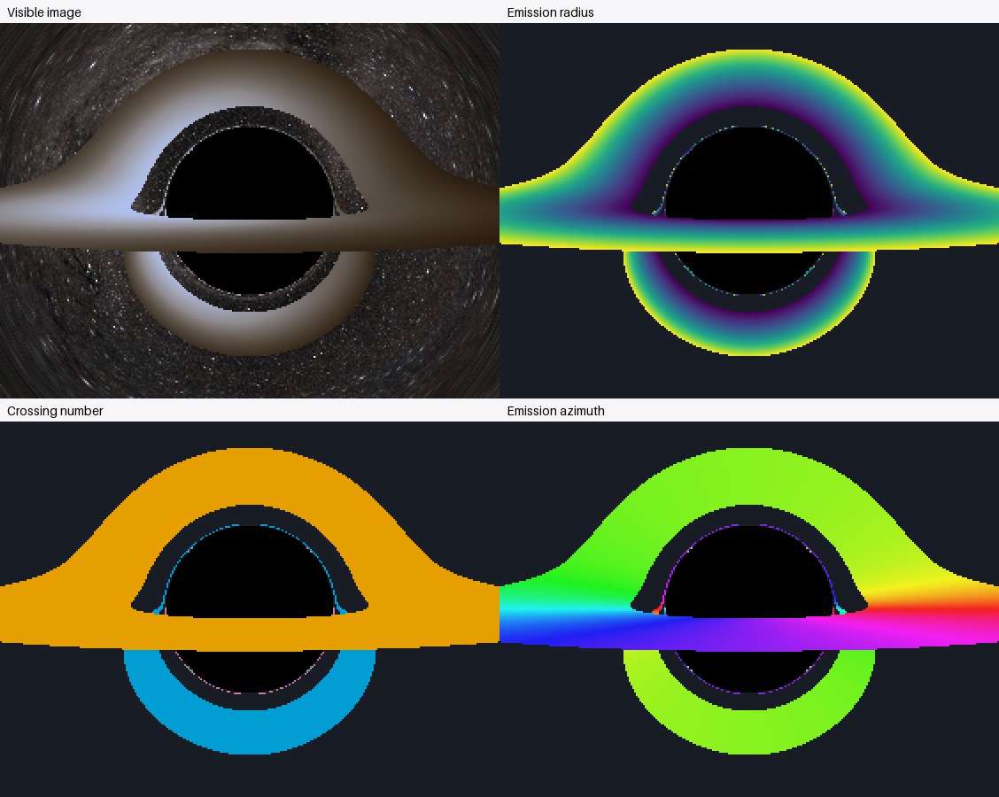

# First-hit diagnostics of the nearly edge-on disk

The saved 640×480 blackbody render in `output/disk-edge-on-blackbody-hires` was
postprocessed without retracing any geodesics. It uses a camera at 60M, FOV 60°,
85° disk inclination, radii 6–20M, one ray per pixel and ten CPU workers.
All 22,694 emitting samples have valid radius, crossing and azimuth information.
The stored radius equals norm(hit_position) exactly. No renderer, integration,
emission, palette, multiprocessing or tolerance settings were changed.

## Images and numerical data

| Quantity | Full frame with legend | Matching magnified crop |
|---|---|---|
| Visible-light image | Original `shadow.png` in the input directory | [Visible crop](crops/rendered.png) |
| First emitting radius | [Radius](emission_radius.png) | [Radius crop](crops/emission_radius.png) |
| Ordinal plane crossing | [Crossing](crossing_number.png) | [Crossing crop](crops/crossing_number.png) |
| Emitting azimuth | [Azimuth](emission_azimuth.png) | [Azimuth crop](crops/emission_azimuth.png) |



The common crop is **x=[179,461), y=[134,346)**, measured in original image
pixels from the top-left corner. Its 282×212 pixels are enlarged 4× to 1128×848
using nearest neighbor for all four images, preserving correspondence and
categorical boundaries. The comparison atlas uses 2× enlargement. Neither
enlargement adds angular sampling or resolves new structures. Decorated panels
paste their raster at (20,55); the `*_pixels.png` versions have no margin.

[diagnostic_arrays.npz](diagnostic_arrays.npz) holds the full numerical grids;
[crops/diagnostic_arrays.npz](crops/diagnostic_arrays.npz) holds exactly the same
crop in numerical form. Masks distinguish valid data from nonemission or missing
fields. [metadata.json](metadata.json) records source checksums, bounds, units,
orientation and conventions. The radius/azimuth maps use NaN outside valid
emission. Crossing zero is a missing sentinel read together with `crossing_valid`.
Black denotes captured rays, blue-gray escaped rays, magenta hatch unresolved
rays and gray hatch unavailable/invalid emitted values. There are no unresolved
rays in this example.

The radius is the Schwarzschild coordinate radius of the **first valid opaque
emitting intersection**. It is neither minimum trajectory radius nor apparent
image radius. The plane-crossing ordinal includes previous crossings through
the hole or outside the annulus. It is not converted into a winding or image
order. Values do not depend on visible brightness, exposure or tone mapping.

## Azimuth convention

The saved Cartesian Kerr–Schild disk normal is
n=(0,0.9961946981,0.0871557427). Zero azimuth is the projection of global +X
onto the disk plane, here e0=(1,0,0). Positive 90° is
e90=n cross e0=(0,0.0871557427,-0.9961946981). Thus phi=atan2(x dot e90,
x dot e0), wrapped into [0°,360°), increases in the same sense as positive disk
rotation. For this +Z observer, phi=90° is on the far side and 270° on the near
side. The general implementation uses projected global +Y if +X is parallel
to the normal. Camera orientation does not redefine these disk coordinates.
The cyclic hue legend joins 360° to 0° without a physical seam.

## Measurements of the narrow structures

The following are direct measurements within explicit visual selections, not
assignments of theoretical image order. Selection masks are in
[feature_masks.npz](feature_masks.npz); [feature_statistics.json](feature_statistics.json)
contains exact definitions, values by crossing, row-by-row branch samples and
representative hit coordinates. [region_selection.png](region_selection.png)
marks the narrow-halo annulus and branch boxes. Image-space distances define
only the visual selections; all physical radii/angles come from saved hits.

The thin-halo selections use apparent distance 46–50 pixels from (319.5,239.5),
excluding the opaque foreground strip: upper y<232 and lower y>=264. Branch
boxes are x=[260,278) or [362,380), y=[220,244). These boxes include neighboring
foreground emission, so counts are separated by the recorded crossing.

| Selected structure/layer | Samples | Emitting radii | Emitting azimuths |
|---|---:|---:|---|
| Upper thin halo, crossing 2 | 82 | 6.062–18.884M | 244.03°–295.97° |
| Adjacent upper halo, crossing 3 | 4 | 8.305–8.387M | 84.71°–95.29° |
| Lower thin halo, crossing 3 | 50 | 6.110–18.169M | 261.60°–278.40° |
| Adjacent lower halo, crossing 4 | 4 | 12.743–12.957M | 84.71°–95.29° |
| Left curved branch, crossing 2 | 33 | 6.062–19.310M | 281.25° through 360°/0° to 29.12° |
| Right curved branch, crossing 2 | 33 | 6.062–19.310M | 150.88°–258.75° |

Each branch box additionally contains 28 crossing-1 and four crossing-3 samples;
these are distinct nearby layers, not silently assigned to crossing 2. Across
the entire frame the recorded category counts are 18,520 / 4,108 / 62 / 4 for
crossings 1 / 2 / 3 / 4.

**The halo and branches sample a broad radial range, rather than exclusively
the inner edge.** For example, along source row y=192, x=310 and x=313 both hit
on crossing 2, at 17.864M and 6.471M respectively. Along the left branch at y=240,
x=266 and x=269 give 19.310M and 6.854M, both crossing 2. Their azimuths are
6.120° and 6.481°, respectively. The right branch gives matching radii at x=373
and x=370, with azimuths 173.880° and 173.519°. These are directly sampled
limits; the narrow image does not necessarily sample the exact 6M or 20M edges.

**The upper thin arc and both outward curved branches share a crossing-2
layer. The full visually near-shadow halo is not one uniform crossing family.**
The thin lower arc is predominantly crossing 3, and neighboring pixels include
crossings 3 and 4. For example, (x,y)=(286,205) is crossing 2 at phi=274.84°;
its neighbor (287,205) is crossing 3 at phi=94.69°. Likewise (284,272) is
crossing 3 at phi=264.56°, while (285,272) is crossing 4 at phi=84.71°. These
are category/source-sector changes, not a smooth color blend or an angle-wrap
artifact.

The complete sampled upper crossing-2 thin structure (all such hits with y<244)
has 128 samples. Its azimuths occupy 22 ten-degree bins and fit a shortest
circular interval of **238.23°**, from 150.88° through 360°/0° to 29.12°. This
establishes contributions from a broad set of disk sectors when the curved
branches are included. It does not demonstrate a visible image of the entire
circumference. The upper crown alone samples roughly 52° in that layer, and
the measured lower crossing-3 thin arc samples only about 17°.

## Interpretation and sampling limits

Within the crossing-2 layer, the cyclic azimuth changes progressively from the
upper crown into the branches; the left branch crosses the 0°/360° convention
without a physical discontinuity. Neighboring available branch-row circular
means differ by at most 12.79°. This is consistent with one related mapped
layer across the crown and both branches. It is not proof of mathematical
continuity at every point: the upper thin structure consists of 26 separate
eight-connected pixel components at this sampling. Many sections are a single
pixel thick or missed between pixels. Radius values can jump between available
row samples as the narrow radial image moves across the pixel lattice, despite
the clear radial progression across its resolved width.

The apparent halo therefore includes multiple sampled layers; proximity to the
shadow alone does not identify a photon ring, an alignment ring or a particular
image order. Neither this data nor crossing counts establish total orbital
winding or the relation to a second alignment ring. Accumulated orbital angle
and detailed hit/miss boundary diagnostics are still needed for those claims.

## Validation and reproduction

The synthetic tests cover known radii and tilted-plane azimuths, wraparound,
invalid/missing values, later valid hits after a hole crossing, higher crossing
categories, exact raster/crop positions, supersampled files and the optional
window camera's exact full-camera ray mapping. Saved 1/5/10/20-worker benchmark
files produce identical extracted arrays. Separately, all extracted fields in
the earlier serial 640×480 thermal render and this ten-worker blackbody render
agree exactly, confirming palette independence and saved-run consistency.
Representative position/plane residuals are recorded in `feature_statistics.json`.
The complete suite passed **86 tests in 92.67 seconds**; the 14 diagnostic tests
were rerun successfully after the final crop-output changes.

```text
python -m numerical_observatory.disk_diagnostics
python examples/analyze_disk_diagnostics.py
python -m pytest -q
```

The default crop is magnification only. The separate optional
`numerical_observatory.diagnostic_zoom` command can explicitly trace a window
on a denser virtual full-camera grid using unchanged integration settings; see
the root README. It is deliberately serial without centered full-frame reuse,
so it may be expensive. No new tracing was launched for this report. Older
data missing `hit_position`/normal cannot provide azimuth, and data missing
`crossing_index` cannot provide crossing number; unavailable fields are masked
and warned about instead of being guessed.
