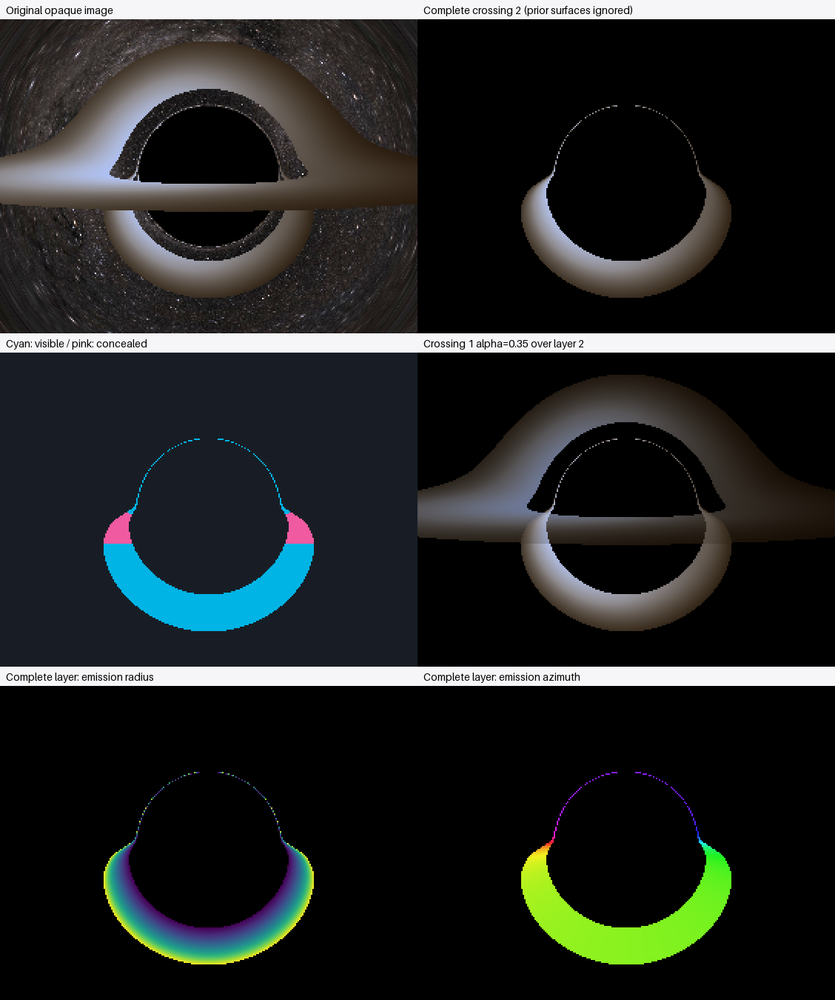

# Revealing the hidden crossing-2 disk image

**The new hidden pixels connect both branch bases to the broad lower crescent.**
The complete crossing-2 image has 4,668 emitting pixels: 4,108 normally visible
and **560 concealed by crossing 1**. A single 4,592-pixel component contains all
560 newly revealed pixels, both branch bases and the entire sampled broad lower
crescent. Much of the narrow upper crown is still raster-disconnected. Source
coordinates and explicit subpixel probes support a related continuous lensed
image family, while the native raster alone does not prove global continuity.

## Images and arrays

| Product | Link |
|---|---|
| Original opaque image | [Opaque](views/opaque.png) |
| Complete second plane-crossing image | [Crossing 2](views/crossing_2.png) |
| First / third / fourth layers | [Crossing 1](views/crossing_1.png), [Crossing 3](views/crossing_3.png), [Crossing 4](views/crossing_4.png) |
| Partly transparent crossing 1 over crossing 2 | [Diagnostic composite](views/composite.png) |
| Crossing-1 foreground boundary on crossing 2 | [Outlined layer](views/crossing_2_foreground_outline.png) |
| Normally visible versus concealed | [Visibility map](views/visibility.png) |
| Hole / annulus / beyond-edge intersection | [Region map](views/intersection_region.png) |
| Full crossing-2 source coordinates | [Radius](views/emission_radius.png), [azimuth](views/emission_azimuth.png) |
| Valid layer-2 emitting intersection | [Mask](views/valid_mask.png) |



All crops use **x=[179,461), y=[134,346)** from the original 640×480 camera image.
The [individual crops](views/crops) are 4× nearest-neighbor magnifications of
282×212 native pixels; the atlas is 2×. They add no physical angular resolution.
No large supersampled image or high-density window was launched.

Numerical intersections: [disk_layers.npz](disk_layers.npz). Configuration,
termination and timing: [trace_metadata.json](trace_metadata.json). Layer-2
grids/masks: [target_arrays.npz](views/target_arrays.npz) and
[cropped arrays](views/crops/target_arrays.npz). Numerical connectivity and
paths: [continuity.json](views/continuity.json) and
[continuity_arrays.npz](views/continuity_arrays.npz). Display and crop details:
[view_metadata.json](views/view_metadata.json). The source render and previous
diagnostic products remain intact.

## What was calculated

The camera is at 60M, horizontal FOV 60°, with 640×480 output, disk inclination
85°, radii 6–20M and the existing blackbody/exposure settings. The old file saved
only first valid emitting hits and cannot supply hidden later intersections.
This experiment therefore calculates new intersections along the same null
geodesics, using a separate opt-in diagnostic.

The analytic Schwarzschild backend extends the already validated orbital and
partial-phase quadratures. Conserved E,L and the fixed orbital plane determine
successive plane roots. Inward/outward radial branches and turning points are
handled separately, with full spacetime events, affine parameters and photon
covectors reconstructed. Capture, finite escape sphere and max-affine settings
are the same as the source. Prior material does not modify the trajectory.
Every emitting event uses the original circular emitter velocity, covector
frequency ratio, temperature law, g^4 bolometric radiance and display processing.

The ODE backend uses the existing Hamiltonian trajectory, dense output and plane
root detection without a surface termination. All recorded plane crossings count,
including the hole and the region outside the annulus. Only valid material hits
increment `emitting_ordinal`. An emitting crossing 2 is not necessarily emitting
hit 2, and a missed crossing 2 never borrows crossing-3 emission.

Examples from the actual data, coordinates (column,row):

| Ray | Successive plane-hit radii | Meaning |
|---|---|---|
| (310,192) | 3.437M, 17.864M | Hole then material: crossing 2 is normally visible and emitting hit 1 |
| (260,250) | 12.038M, 9.946M | Material then material: crossing 2 is concealed and emitting hit 2 |
| (319,310) | 35.925M, 11.711M | Beyond outer edge then material: crossing 2 is emitting hit 1 |
| (285,272) | 24.509M, 3.182M, 3.151M, 12.957M | Outside, hole, hole, material: crossing 4 is emitting hit 1 |

The full table contains **220,080 plane crossings**: 6,208 in the hole, 23,272
in the material annulus and 190,600 beyond its outer edge. There are no unresolved
rays or recording-limit truncations in this reference experiment. Configuring
a different maximum remains possible and is explicitly tracked in the data.

| Plane ordinal | Recorded plane hits | Valid emitting hits | Normally concealed emitting hits |
|---|---:|---:|---:|
| 1 | 204,158 | 18,520 | 0 |
| 2 | 15,704 | 4,668 | 560 |
| 3 | 212 | 80 | 18 |
| 4 | 6 | 4 | 0 |

Layer images have a black empty background: black means no valid material hit
at that selected ordinal, not necessarily black-hole capture. Visibility uses
cyan for normally visible emission and pink for concealed emission. The scalar
radius and cyclic azimuth conventions are the same as the earlier disk maps.
The two-layer composite blends separately tone-mapped display-linear RGB with
crossing-1 alpha 0.35. It is not physical partial opacity, radiative transfer,
attenuation or a sum of bolometric intensities.

## Connectivity and source-coordinate evidence

1. **Raster connectivity:** originally visible crossing-2 pixels form 27
   eight-connected components. The complete layer forms 25, with a largest
   component of 4,592 pixels (**98.37%** of the layer). All 560 hidden pixels
   lie in it. This joins the broad lower crescent to both branch bases, merging
   three formerly separated visible pieces. No dilation, hole filling,
   interpolation or fabricated intersection was used.
2. **Feature memberships:** reusing the previous masks, that main component
   contains all 3,980 broad-lower-crescent pixels, 26 of 33 normally visible
   pixels in each branch box, and six of 82 selected upper-halo pixels. The
   remaining 76 layer pixels are in 24 small upper-structure components. These
   masks overlap, so feature counts are not additive. The entire upper crown is
   not a single sampled connected component.
3. **Source mapping through hidden regions:** each actual sampled bridge path
   from the connected branch flank to the lower crescent uses 52 native pixels,
   including 21 concealed pixels. The left path runs from (272,229) to (260,280);
   the right is its exact reflected path. Every step is an actual eight-neighbor
   emitting crossing-2 pixel. Source azimuth evolves from 291.52° through 360°/0°
   to 82.70° on the left, and 248.48° to 97.30° on the right. Wrapping is treated
   circularly rather than as a physical discontinuity.
4. **Measured gradients:** inside the concealed part of these paths the median
   adjacent radius change is 0.488M (maximum 1.148M), and median circular azimuth
   change is 1.389° (maximum 8.130°). Across all 132 visibility-boundary neighbor
   edges, median changes are 0.546M and 0.587°, with maxima 4.784M and 10.233°.
   These sampled gradients are consistent with a changing source map through
   the newly revealed strips. They are not a mathematical continuity test.
5. **Remaining narrow-image sampling:** along the whole path, near the very
   thin upper section, adjacent radial samples can differ by 11.879M. A fixed
   pixel lattice can jump across a compressed 6–20M radial image. The large
   gradient is not silently smoothed or asserted to be a physical discontinuity.

The complete layer samples r_emit=6.0069–19.9889M. Its newly concealed portion
samples **6.0311–19.9294M**, so the revealed bridges also contain a broad radial
range. The new concealed azimuths are 26.92°–153.08°, joining the branches toward
the far-side sectors of the lower crescent. Equal ordinal alone does not imply
a continuous source map; the additional position, source-coordinate and bridge
measurements are the evidence here.

### A direct sampling-gap test at the upper crown

Five explicit individual-ray probes, also checked against the ODE, investigate
the central crown gap without creating a denser image:

| Camera-image ray center | Crossing-2 radius | Material? |
|---|---:|---|
| (319,191), native pixel | 21.8015M | Outside the outer edge |
| (319,192), native pixel | 3.5484M | In the hole |
| (319.5,191.25), fractional position | 11.2378M | Yes |
| (319.5,191.5), fractional position | 7.0939M | Yes |
| (319.5,191.75), fractional position | 4.8892M | In the hole |

Thus at least part of the apparent crown disconnection is demonstrably a missed
thin emitting band between native pixel rows. These are newly calculated null
geodesics, not interpolated radius values or filled image pixels. They do not
prove that every remaining raster gap has the same cause.

**Interpretation:** the evidence strongly supports treating the upper thin
halo, widening branches and lower crescent as portions of a related crossing-2
lensed image, partly hidden by crossing 1. Removing the foreground reveals the
expected bridges; their source coordinates evolve consistently to sampled
accuracy. Strictly, this raster is still not one connected set, and a complete
proof of source-map topology would require targeted sampling of the remaining
gaps. Neither raster connectivity nor plane-crossing ordinal assigns photon
winding number or a definitive higher-order-image taxonomy.

## Numerical validation and compatibility

All **4,108 normally visible crossing-2 samples agree exactly** with the earlier
opaque crossing-number mask, with zero false positives or false negatives.
First-valid-hit categories agree across the full image. The independently
reconstructed opaque PNG matches the saved original at every 8-bit channel,
while the original PNG is also preserved separately as the reference.

Quadrature states differ slightly from finite-tolerance saved ODE states:
maximum first-hit position difference 2.865e-6M, g difference 4.794e-8, and
relative bolometric difference 6.468e-7. These are explicitly measured, not
assumed bitwise state equality between different numerical methods.

An independent audit uses 12 representative rays at original and tightened
validation tolerances, plus five crown probes: **29 small ODE integrations**,
not a full image rerender. It checks all successive events, regions and emitting
ordinals, including later material hits behind earlier material. Tight-run maxima:

| Quantity | Maximum absolute difference (unless relative) |
|---|---:|
| Spacetime event Euclidean difference | 5.23e-8M |
| Affine parameter | 3.34e-8M |
| Photon covector | 1.17e-9 |
| Accumulated orbital angle | 2.06e-12 rad |
| Frequency-shift factor g | 4.48e-11 |
| Bolometric intensity, relative | 7.25e-9 |
| g against independent explicit circular-orbit formula | 4.45e-16 |

The explicit g check uses the conserved photon energy, disk-normal angular
momentum and circular angular velocity separately from the generic covector
contraction. All later emission still calls the existing production functions.
The maximum null residual at reconstructed crossing states is 6.21e-15. This
is an analytic-state check, not an ODE path-conservation measurement. The ODE
backend retains the existing accepted-step/dense-midpoint prefix checks.
See [validation.json](validation.json) for all values and subpixel probes.

The tests cover plane versus emitting ordinals, hole/outer misses, later hits,
redshift and intensity, ordering and deduplication, ordinary first-hit agreement,
visibility, worker-count stability, exact window geometry, recording/affine
limits, coplanar ambiguity, and palette/crop repainting without new trajectories.
They also verify the normal opaque PNG is unchanged before and after collecting
layers. Serial and spawned-worker results for each numerical method are
bit-identical, assembled in ray order. Existing numerical tests are preserved.

The complete suite passed: **127 tests in 124.87 seconds**. The final run used
`python -m pytest -q --basetemp output/test-temp-layers-final-20261030`
because this managed Windows sandbox could not create pytest directories in its
system temporary location. No tests or tolerances were weakened. The test log is
`output/disk-layers-test-results.txt`.

## Cost, reproduction and limitations

The reference collection used 10 workers and 28,772 exact radial-geometry groups,
with **no ODE fallback** for the 307,200 reference rays. Collection and assembly
took about **50 seconds**, plus compressed output and presentation. The compact
intersection file is about 21.7 MB. ODE mode is available for independent audits
or cameras incompatible with the quadrature optimization; a full ODE image was
not automatically launched. Original physical and numerical settings are intact.

```powershell
.\.venv\Scripts\python -m numerical_observatory.disk_layers --input-render output/disk-edge-on-blackbody-hires --workers 10 --method quadrature --max-crossing 4 --crop 179 134 461 346 --output examples/disk_layer_analysis
.\.venv\Scripts\python examples/validate_disk_layers.py
```

On Ubuntu replace the interpreter with `.venv/bin/python`. The new independent
configuration `examples/disk_layers.toml` can be used with `--config` instead
of the reference render. For subsequent changes, do not retrace:

```text
python -m numerical_observatory.disk_layers --reuse examples/disk_layer_analysis --target 2 --alpha 0.2 --output output/layers-alpha02
python -m numerical_observatory.disk_layers --reuse examples/disk_layer_analysis --target 3 --output output/layer-three
```

The root README explains the structured sparse table, region/status codes,
window geometry, palette overrides and crop customization. A native window
around y≈236–266 can cheaply investigate the concealed strips. Explicit density
4–8 in small crown/branch windows would help resolve remaining sampling gaps;
the full image should not be supersampled automatically.

Important limits: coplanar infinitesimally thin rays are ambiguous and unresolved;
critical/warning-producing quadratures fall back to the unchanged ODE path;
recorded states stop at the configured ordinal maximum. ODE caching still
integrates to its natural termination for reuse and constraint diagnostics, so
very high-deflection ODE paths may cost more even with a low recording maximum.
When the maximum is too low to establish a first opaque hit, reconstruction is
marked unknown rather than substituting a later event or pretending to see sky.
Higher maxima are supported without allocating a dense pixel-by-maximum state
cube. No opacity, absorption, scattering or radiative transfer has been added.
