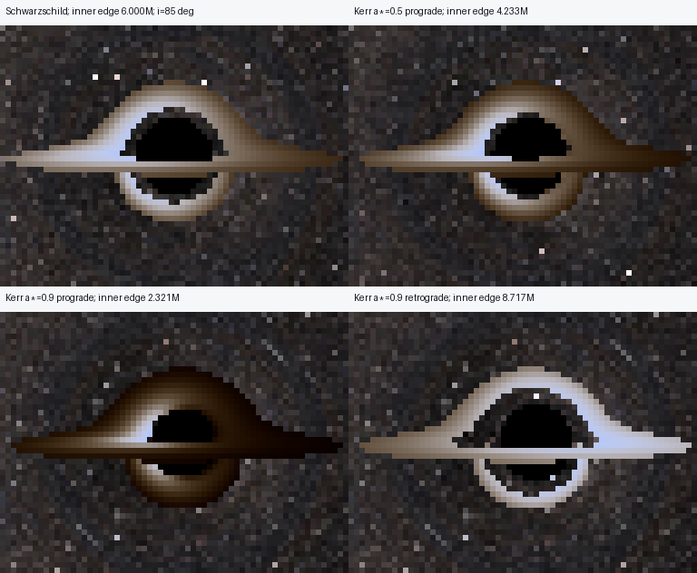

# Kerr accretion disk: validation and previews

Checked 2026-10-31. Exact Kerr photon trajectories now support a stationary,
equatorial, thin opaque disk of circular-geodesic emitters. The existing surface
renderer, invariant frequency transfer and blackbody/thermal/gray display code
are reused. No Kerr disk approximation is inserted into the photon equations.



The four panels use the same r_camera=60M, inclination=85°, FOV=60°, outer
radius 20M, T_in=10000K, blackbody palette and exposure 5. Native images are
96×72 with one ray per pixel. This figure uses identical source bounds
x=[16,80), y=[12,60), enlarged 6× with nearest-neighbor interpolation. It adds
**no physical angular resolution**. [Full comparison](comparison.png),
[all six Kerr views](all_kerr_previews.png), and [crop metadata](comparison_crop.json)
are available separately.

## Physical model

Spin is dimensionless a*=J/M² about +Z. The disk stays at z=0 regardless of
spin sign. Prograde follows J; retrograde opposes it. At zero spin prograde
means +phi and retrograde means -phi. The exact ISCO is the default inner edge;
explicit radii below the selected ISCO are rejected. The coordinate directions
and resolved physical radii are saved. Representative ISCOs:

| Orbit | Spin 0 | Magnitude 0.5 | Magnitude 0.9 | Magnitude 0.99 |
|---|---:|---:|---:|---:|
| Prograde r/M | 6.000000 | 4.233003 | 2.320883 | 1.454498 |
| Retrograde r/M | 6.000000 | 7.554585 | 8.717352 | 8.971861 |

The ISCO formula's small-spin cancellation was demonstrated against the
independent marginal-stability root: at a*=1e-8 the direct formula rounded to
6M, missing a 3.27e-8M shift. The exact algebraic identity
3-Z1=a*²(3Z1-1)/Z1² now evaluates the small-spin branch without that loss.
This changes neither the photon solver nor any tolerance or physical model.

Kerr annulus membership, temperature and saved emission radius all use **Kerr r**.
At z=0 the Cartesian cylindrical radius is sqrt(r²+a²). Emitters have
u=ut(k+Omega m), k=(1,0,0,0), m=(0,-y,x,0), with Kerr Omega and metric-based
normalization. Because the BL-to-outgoing-KS shifts depend only on r, they are
constant on a circular equatorial worldline; these Killing vectors are already
the correctly transformed Cartesian velocity construction.

Every plane crossing counts, including holes and outside-edge misses. The
first valid emitting annulus intersection is opaque. It may precede capture;
a foreground disk hit then correctly replaces the black-hole/background result.
The solver can retain later geometry internally, but physical radiance and
constraint samples stop at the first hit. No Kerr spherical caching is enabled.

The actual finite-camera ZAMO/static/custom-frame velocity is used. For past
covectors positive frequencies are p.u; the ratio is equivalent to the physical
future-photon -p.u convention. Invalid frequencies are rejected. The existing
I_obs=g^4 I_emit law is unchanged, without an extra lensing or Doppler factor.
The CIE blackbody palette is unchanged and uses g*T_emit only for chromaticity.

## Independent numerical validation

Validation uses BL radial geodesic equilibrium, the timelike radial potential,
conserved orbital E/Lz, canonical Hamiltonian circular-worldline residuals, and
the separate Carter-equation photon solver. It does not rely on image appearance.

Across spins 0, +/-0.5, +/-0.9, +/-0.99, both orbit directions, three radii and
three azimuths per orbit:

| Check | Largest measured error |
|---|---:|
| ISCO vs independent R''=0 marginal-stability root | 2.10e-13 M |
| Emitter u.g.u+1 | 3.11e-15 |
| Full canonical circular-geodesic residual | 8.88e-15 |
| Orbital specific energy vs BL reference | 4.11e-15 |
| Orbital Lz vs BL reference | 1.18e-14 M |

Automated tests also integrate timelike circular orbits for two proper-time
periods and check their radial stability and conserved quantities. The Kerr
metric, Hamiltonian equations, camera projection and production tolerances are
unchanged.

Selected first-hit rays below use rtol=1e-11, atol=1e-13, with a tighter production
check and an independent exterior Carter trajectory. Event error is the maximum
absolute difference among coordinate components (T,x,y,z), not an invariant
spacetime distance. The BL frequency reference uses conserved E,Lz and the
actual finite observer: nu=ut(-E+Omega Lz) for the past covector. Root accuracy
and local frequency accuracy are distinct checks.

| Probe | Plane ordinal | Emission r/M | g | Independent event error (M) | Relative g error |
|---|---:|---:|---:|---:|---:|
| crossing1 | 1 | 9.913281 | 1.080112 | 2.02e-11 | 3.13e-14 |
| crossing2 | 2 | 12.256287 | 0.843986 | 1.44e-06 | 9.3e-14 |
| crossing3 | 3 | 9.335967 | 1.013867 | 3e-07 | 3.54e-13 |
| crossing4 | 4 | 11.130881 | 0.916221 | 9.55e-06 | 2.36e-13 |
| approaching | 1 | 9.733672 | 1.035654 | 2.16e-11 | 1.11e-15 |
| receding | 1 | 9.704170 | 0.727126 | 2.07e-11 | 2.07e-14 |
| negative_spin | 1 | 9.733672 | 1.035654 | 2.05e-11 | 1.11e-15 |
| high_spin_ergosphere | 1 | 1.465155 | 0.172346 | 1.73e-08 | 9.77e-15 |
| captured_without_disk | 1 | 8.627844 | 0.808780 | 3.58e-11 | 2.22e-16 |

The third-crossing example passes first outside 20M, then through the inner
hole, before emitting at 9.336M. The fourth-crossing example has earlier radii
29.994M, 3.334M and 3.272M before reaching 11.131M. No missed crossing borrows
emission from a different ordinal. The approaching/receding examples are near
9.7M but give g=1.036 and 0.727, respectively. The negative-spin counterpart
has the matching reflected shift. The spin-0.99 example emits at 1.465M, inside
the equatorial ergosurface r=2M but outside its 1.454M ISCO; its circular emitter
remains timelike. Substituting a static emitter there would be invalid.

Data: [physical_validation.json](physical_validation.json).

## Zero-spin equivalence and sign conventions

The full zero-spin preview and existing Schwarzschild control use matching
physical observers, equatorial disks, axes, FOV, temperature and display.
Schwarzschild retains its exact rotational trajectory reuse; Kerr takes the
general ODE path. Across all 6,912 rays:

- Status differences: **0**; plane-crossing differences: **0**.
- Maximum hit-position difference: **1.544e-8 M**.
- Maximum g difference: **9.819e-10**.
- Maximum relative bolometric intensity difference: **3.389e-9**.
- Displayed PNG pixel differences: **0**.

A second audit explicitly rotates the legacy +Z camera / tilted Schwarzschild
disk to the equatorial Kerr setup. For inclination i, its rotation matrix is
[[0,-cos(i),sin(i)],[1,0,0],[0,sin(i),cos(i)]]. The disk normal, camera, axes,
positions, momenta and velocities are rotated together. Selected rays cover
first through fourth emission crossings, capture and escape. Maximum rotated
position disagreement is 1.35e-8 M, g difference 2.75e-11, and linear-RGB
difference 8.19e-10. Mismatched camera/disk conventions are not compared.

For +/-0.9 prograde previews, reflecting global Y and image columns gives
zero status/crossing differences, maximum emitting-position disagreement
7.14e-9 M, g difference 2.28e-10 and relative intensity difference 1.99e-9.
The normal remains +Z. A nonsymmetric photographic sky need not itself have
mirror-symmetric colors.

Data: [full zero-spin](zero_spin_comparison.json),
[rotated legacy convention](rotated_zero_spin_comparison.json),
[spin reversal](spin_reversal_comparison.json).

## Preview measurements and interpretation

All Kerr cases trace 6,912 distinct rays with ten spawn workers, no supersampling
and no spherical reuse. The Schwarzschild control generates the same ray grid
but integrates only 780 distinct geometries with its existing exact reuse.
Reported renderer times include worker startup/communication; these are observed
example timings, not a controlled worker-count speedup benchmark. Some checks
ran concurrently, so host contention can affect them.

| Case | Inner edge (M) | Captured | Escaped | Emitted | Unresolved | Renderer time (s) |
|---|---:|---:|---:|---:|---:|---:|
| schwarzschild_i85 | 6.000000 | 116 | 6296 | 500 | 0 | 15.28 |
| spin0_prograde_i85 | 6.000000 | 116 | 6296 | 500 | 0 | 120.32 |
| spin05_prograde_i85 | 4.233003 | 108 | 6236 | 568 | 0 | 134.25 |
| spin09_prograde_i85 | 2.320883 | 75 | 6211 | 626 | 0 | 127.20 |
| spin09_retrograde_i85 | 8.717352 | 115 | 6368 | 429 | 0 | 123.22 |
| spin_minus09_prograde_i85 | 2.320883 | 75 | 6211 | 626 | 0 | 128.87 |
| spin09_prograde_i60 | 2.320883 | 65 | 5194 | 1653 | 0 | 117.50 |

Maximum sampled normalized Kerr preview errors (including background tails for
escaping rays) are 1.20e-7 for the null constraint, 0 for stationary energy,
6.37e-8 for axial angular momentum and 6.80e-7 for Q. The unchanged production
null threshold is 1e-5. Emitting rays are audited only through the first opaque
hit. Tests demonstrate that bad later unused geometry cannot invalidate a
valid earlier hit, while bad pre-hit constraints remain unresolved.

The images show a smaller prograde emitting inner edge and a larger retrograde
one, while coordinate motion reverses the bright approaching side. Changes
between spins combine photon frame dragging, ISCO/geometry and emitter motion;
the image alone does not isolate one cause. Spin-0.9 prograde is markedly
warmer/dimmer in outer portions than retrograde under these settings because
T_in is anchored at the different ISCOs. Equal T_in and exposure are **not** equal
accretion rate or luminosity. This is the defined toy profile, not a color tweak.

Captured counts in a disk image are not shadow-area measurements: foreground
emission can replace an otherwise captured ray. Thin upper/lower structures
can be only one native pixel wide. Spin-0.5 has two third-crossing pixels and
one fourth-crossing pixel; spin-0.9 retrograde has one third-crossing pixel.
Those observations do not establish winding numbers or resolve entire image
families. No artificial rings, blur, glow or brightness multiplier is added.

## Data, diagnostics and reproduction

Each case folder contains `shadow.png`, `disk_rays.npz` and `diagnostics.json`.
Kerr files preserve legacy disk fields and add actual hit events/covectors,
affine values, emitted temperature/intensity, outgoing-KS azimuth and E/Lz/Q/null
diagnostics. Source directions and statuses remain available. Radius, crossing
and azimuth maps with underlying arrays are in `diagnostics/<case>/`; grid
companions in `grid/<case>/` reuse identical physical ray data.

Example maps: [radius](diagnostics/spin09_prograde_i85/emission_radius.png),
[crossing](diagnostics/spin09_prograde_i85/crossing_number.png),
[azimuth](diagnostics/spin09_prograde_i85/emission_azimuth.png),
[arrays](diagnostics/spin09_prograde_i85/diagnostic_arrays.npz).
Azimuth is outgoing Cartesian KS atan2(y,x), zero +X, positive toward +Y about
+Z, modulo 360 degrees; it is not BL phi. The radial diagnostic and its
position fallback now correctly use Kerr r, not Euclidean position norm.

PowerShell:

```powershell
.\.venv\Scripts\python -m numerical_observatory --config examples/kerr_disks/configs/spin09_prograde_i85.toml --workers 10 --output output/kerr-disk
.\.venv\Scripts\python -m numerical_observatory --config examples/kerr_disks/configs/spin09_retrograde_i85.toml --background grid --workers 10 --output output/kerr-retro-grid
.\.venv\Scripts\python -m numerical_observatory.kerr_disk_validation --render --workers 10
.\.venv\Scripts\python -m numerical_observatory.disk_diagnostics --input output/kerr-disk --output output/kerr-disk-maps
```

Ubuntu replaces the interpreter with `.venv/bin/python`; all arguments and
paths are identical. `--figures-only` repaints saved examples without tracing;
without `--render` only selected numerical audits run. Recoloring is available
through `python -m numerical_observatory.surface_render --input ... --output ...
--palette thermal --exposure 3`. The physical NPZ remains read-only.
The [guide](README.md) documents the full schema, saved fields and optional
explicit higher-resolution/targeted-window commands.

## Tests and limitations

The final complete suite passed: **193 tests in 204.94 seconds**. All existing
physical tolerances are preserved. The obsolete assertion that Kerr disks must
be rejected was updated to check the newly supported factory; no old numerical
assertion was weakened. The suite covers ISCO stability, normalization and full
circular-geodesic residuals, time-integrated orbits, first through fourth hits,
holes/outside-edge misses, frame/transfer signs, opacity, capture/unresolved,
near-tangent/coplanar rays, zero spin, spin reflection, saved maps, repainting,
serial/spawned equality and supersampling. A final small-spin regression
verifies the cancellation-safe ISCO formula.

A disk-disabled Kerr control was saved before implementation: afterward its
PNG and **every numerical ray array match exactly**. Existing Schwarzschild
high-resolution source files were kept intact. No Git commands were run.

An additional extreme seventh-crossing probe is **not independently certified**.
The production endpoint converges as rtol tightens from 1e-11 to 1e-13 and its
null residual decreases from 1.82e-10 to 2.82e-12. However, even tightening the
existing double-precision second-order Carter reference to rtol=2.5e-14 leaves
about 0.0122M maximum coordinate-component disagreement, above the unchanged
0.0003M audit criterion. This reference-precision failure is explicitly saved
in [nearcritical_reference_limit.json](nearcritical_reference_limit.json).
Reproduce it with `python -m numerical_observatory.kerr_disk_validation
--nearcritical-audit`. It is not relabeled a pass, and does not certify narrower
higher-order structures. No failed-null ray is forced to emit.

Other limits: infinitesimal coplanar ambiguity; finite sampling and boundary
localization; sampled rather than rigorous global conservation bounds; the
existing finite far-field background continuation; and CPU cost from tracing
independent Kerr trajectories, including unused post-hit geometry. Kerr
multilayer and Schwarzschild planar orbital-angle/alignment-ring analyses are
explicitly unsupported for Kerr. No hydro, self-gravity, tilted disk, plunge
emission, Novikov–Thorne profile, returning-radiation transport or partial
transparency is implemented. Higher-resolution images are provided as commands,
not automatically launched. Improving the extreme reference and resolving thin
features are useful next experiments; neither justifies altering the physics.

Theory: [Bardeen, Press & Teukolsky (1972)](https://doi.org/10.1086/151796),
[SageManifolds Kerr circular-orbit reference](https://sagemanifolds.obspm.fr/kerrgeodesic_gw/reference/kerr_spacetime.html),
and the project's already validated exact-Kerr metric/Carter equations.
