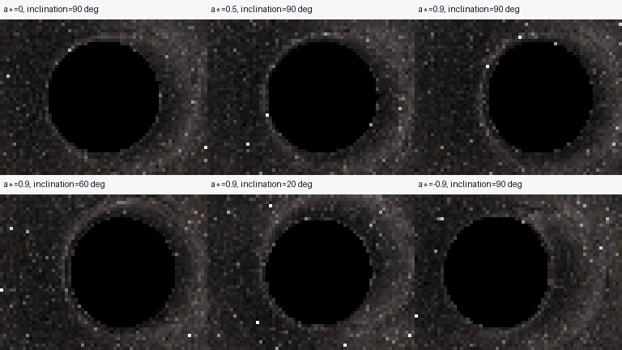
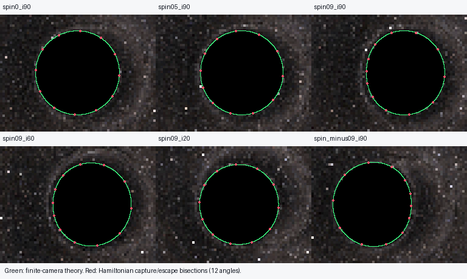

# Exact Kerr: shadow and background validation

Implementation checked on 2026-10-31. This milestone adds the exact rotating
vacuum spacetime and celestial lensing, **without a Kerr accretion disk**.



All six scenes use M=1, Kerr r=30M, horizontal FOV=35°, 64×48 native pixels,
ZAMO observers, rtol=1e-9, atol=1e-11, escape r=80M, and the same photographic
background/display. Positive spin is about +Z. The 4× nearest-neighbor figure
is a magnification of a small preview, not additional ray-tracing resolution.
The comparison includes the requested spins/inclinations; no large-resolution
batch was launched.

[Matching celestial-grid comparison](grid_comparison.png) uses exactly the same
saved escaping directions, with no additional integrations. Each case directory
contains shadow.png, grid.png, rays.npz, diagnostics.json and a theory overlay.

## Independently calculated shadow boundary



Green curves use the conserved spherical-photon constants xi=Lz/E and eta=Q/E²
from R=R'=0. For each orbit the corresponding null covector at the actual
finite camera is constructed in Boyer–Lindquist (BL) coordinates, transformed
with the full outgoing-KS Jacobian, then projected into the actual camera tetrad
and pinhole projection. No distant-observer alpha/beta coordinates are equated
with finite-camera pixels. No theoretical displacement is added to images.

Red points are Hamiltonian capture/escape bisections at **12 image-plane radial
angles per case**, offset from symmetry axes. Each uses a bracket, independent
capture/escape decisions, and final bracket width below 0.0001 pixel. The
analytic reference only seeds the bracket. Error is distance along the same
image-plane radial line. Maximum and RMS below refer to these 12 probes,
not a rigorously bounded maximum over the continuous curve. Curve interpolation
is another small error source; dense analytical points are saved separately.

Image coordinates use zero-based pixel centers; center=(31.5,23.5), right=+x,
rows increase downward. The listed horizontal center is the midpoint of
analytical left/right extrema relative to that image center.

| Case | Horizontal displacement (px) | Half-width (px) | Half-height (px) | Max radial error (px) | RMS error (px) |
|---|---:|---:|---:|---:|---:|
| spin0_i90 | +0.000000 | 17.225568 | 17.225568 | 4.21e-05 | 4.21e-05 |
| spin05_i90 | +3.532657 | 16.982283 | 17.234674 | 4.92e-05 | 3.99e-05 |
| spin09_i90 | +6.870468 | 16.103006 | 17.255052 | 4.86e-05 | 3.72e-05 |
| spin09_i60 | +6.015054 | 16.094078 | 17.039798 | 4.93e-05 | 3.57e-05 |
| spin09_i20 | +2.415323 | 16.220076 | 16.403737 | 4.55e-05 | 3.98e-05 |
| spin_minus09_i90 | -6.870468 | 16.103006 | 17.255052 | 4.86e-05 | 3.72e-05 |

All measured errors are below **0.00005 pixel**, limited by the bisection
resolution. The validation command rejects disagreement above 0.001 pixel.
The actual 64×48 raster boundary has order-one-pixel sampling uncertainty;
subpixel bisections validate the solver independently of that coarse raster.
It would be incorrect to infer this numerical precision by inspecting the PNG.

Spin reversal gives opposite horizontal shifts with identical analytical
width/height. Direct mirrored-ray tests also verify the corresponding source
mapping symmetry; a photographic sky need not itself look mirror symmetric.
The high-spin 20° view is much closer to circular than its equatorial view.

Data: [shadow_validation.json](shadow_validation.json), including brackets,
reference/measured radii, shot counts and conservation maxima;
[analytical_curves.npz](analytical_curves.npz), full projected critical curves.
The zero-spin radius also agrees with the finite-distance Schwarzschild
b_crit=3 sqrt(3)M formula, not a distant-observer approximation.

## Conservation and independent trajectory audit

Production equations are the existing four-dimensional canonical Hamiltonian
system with analytic inverse-metric derivatives. No null-cone projection,
empirical bending or planar approximation is used. The independent reference
integrates Carter's separated second-order radial/polar equations in affine
time, using Mino velocities so radial and polar turning points do not require
square-root sign switches. It does not evaluate production metric derivatives.
The exterior reference is not used as the production renderer.

Across all 18,432 preview rays, sampled maxima including far-field tails are:

- normalized null residual: 1.439e-7;
- normalized energy drift: 0 (stationarity gives exactly zero dp_t);
- normalized axial angular-momentum drift: 8.319e-8;
- normalized Carter-constant drift: 4.828e-7.

E errors are scaled by |E0|, Lz by M|E0| and Q by (M E0)²; these are not
relative errors divided by potentially vanishing Lz or Q. Samples include
accepted endpoints and dense midpoints, not a rigorous between-sample bound.
The preview null threshold stays at the existing 1e-5. Near-critical boundary
shots have measured maxima 1.306e-7 (null) and 4.363e-7 (normalized Q).

Three escaping audit rays at spin 0.9, inclination 60° exercise radial and polar
turns. The following maxima include all three rays; radius comparison is over
the encounter through the escape sphere, while invariant checks include tails.

| rtol / atol | Null residual | Q drift | Radius disagreement with separated reference (M) | Azimuth disagreement (rad) |
|---|---:|---:|---:|---:|
| 1e-07 / 1e-09 | 2.67e-07 | 4.5e-06 | 1.96e-06 | 5.12e-07 |
| 1e-09 / 1e-11 | 3e-09 | 7.57e-08 | 1.83e-08 | 1.92e-09 |
| 1e-11 / 1e-13 | 4.75e-11 | 2.64e-09 | 2.7e-09 | 8.13e-10 |

Invariant errors and independent trajectory disagreements improve with tighter
tolerances. At the tightest level the independent reference's own finite
tolerance also limits comparison accuracy; errors need not decrease by exactly
100× for a 100× rtol change.

The four-angle near-critical boundary convergence audit uses 0.00001-pixel
brackets. At rtol=1e-7, one angle (3.8 rad) is **unresolved**: null residual
1.12352e-5 exceeds the unchanged 1e-5 threshold. It is retained as a failure,
not replaced with an analytical classification. At rtol=1e-9 and 1e-11 all
four boundaries resolve, with identical measured midpoint radii at this bracket
resolution. Among the other loose-tolerance probes the largest midpoint shift
is about 7.315e-6 pixel. This establishes convergence at the resolved scale,
not arbitrary precision near a separatrix.

Changing the capture fraction from 0.98 to 0.995 to 0.999 produces the same
sampled boundary midpoint (20.7181721570 px) within its 1e-5-pixel bracket.
Capture uses the correct oblate Kerr r and outer horizon, never Euclidean
radius or the ergosurface.

The background tail uses the same Hamiltonian ODE to a finite large radius,
then the outgoing Cartesian tangent. For a representative ray the direction
change is 1.7723e-8 between 10^4M and 10^5M, and 1.7717e-10 between 10^5M and
10^6M, consistent with the separate O(M b/R²) truncation error. This is not ODE
error or pixel-sampling error, and no empirical lensing correction is applied.

Detailed data: [convergence.json](convergence.json). Tests additionally cover
near-critical escape, negative spins, the rotation axis, both turning types,
captured/unresolved rays, metric symmetry/inverse/derivatives near the horizon,
ZAMO/static observer distinctions, and source-direction reflection.

## Schwarzschild limit and backward compatibility

At exactly zero spin the Kerr metric, inverse and derivatives evaluate the
existing Schwarzschild expressions exactly. For the three independently
recorded zero-spin comparison rays, main encounter states have **zero numerical
difference** with Schwarzschild ODE states and identical classification. Escaping
source directions differ by at most 1.441e-11 because Kerr uses a numerical
far-field continuation while Schwarzschild keeps its analytical tail.
Camera ZAMO/static tetrads agree at zero spin. The old Schwarzschild orbital
quadrature is a further zero-spin source-direction reference in tests. Small
nonzero spin tests confirm smooth approach to the zero-spin ray mapping.

Existing Schwarzschild configurations, disk physics, palettes, crossing-layer
analysis, quadrature and symmetry reuse remain in place. Kerr-specific spherical
reuse and disk rendering are rejected/disabled, including a Kerr metric at
zero spin. General custom-domain integration remains supported.

## CPU cost

Each case has 3,072 distinct rays, ten spawn workers, no trajectory reuse and
zero unresolved preview rays. Times below are renderer wall time including
worker startup and weak-field tail tracing; these are observed example timings,
not a controlled worker-count speedup benchmark. Host contention may affect them.

| Case | Captured | Escaped | Time (s) | RHS evaluations |
|---|---:|---:|---:|---:|
| spin0_i90 | 936 | 2136 | 46.04 | 2,973,000 |
| spin05_i90 | 916 | 2156 | 57.03 | 3,027,082 |
| spin09_i90 | 882 | 2190 | 55.09 | 3,161,286 |
| spin09_i60 | 868 | 2204 | 53.17 | 3,117,277 |
| spin09_i20 | 835 | 2237 | 53.03 | 3,126,007 |
| spin_minus09_i90 | 882 | 2190 | 52.56 | 3,161,286 |

Workers each peak around 76 MiB (roughly 0.75 GiB together, plus the parent).
Metric/inverse-derivative evaluations dominate the roughly three million RHS
calls per case; the large-radius background continuation adds work. There is
no Schwarzschild-style full rotational reuse. Ten workers is the measured
configuration, not a claim that Kerr's optimal worker count was benchmarked.
A future Carter-separated renderer or carefully validated metric-kernel changes
could improve speed; neither is introduced here.

## Tests and reproduction

The complete existing and new suite passed: **158 tests in 156.26 s**.
After the final null-rejection check/reporting updates, the focused Kerr suite
also passed: **31 tests in 30.49 s**. Serial versus spawned multiprocessing,
supersampled numerical arrays, and disabled incompatible optimizations are
covered. Existing physical tolerances and tests were not weakened.
The managed Windows sandbox needed a workspace-local pytest temporary folder:

```text
python -m pytest -q --basetemp output/test-temp-kerr-full-20261031
```

Windows PowerShell:

```powershell
.\.venv\Scripts\python -m numerical_observatory --config examples/kerr/spin09_i60.toml --workers 10 --output output/kerr-09-60
.\.venv\Scripts\python -m numerical_observatory --config examples/kerr/spin09_i60.toml --background grid --workers 10 --output output/kerr-grid
.\.venv\Scripts\python -m numerical_observatory.kerr_validation --render --workers 10
```

Ubuntu uses the identical arguments with `.venv/bin/python`. Omit `--render`
for numerical audits only; use `--figures-only` to repaint comparisons from
saved directions without tracing. `--output` selects a separate destination.
Use `--width`/`--height` for deliberate higher-resolution single renders; a
large Kerr batch is not automatically launched. Configuration/coordinate and
saved-data details are in [the Kerr guide](../kerr/README.md) and root README.

## Limits and next steps

The supported renderer spins are [-0.99,0.99], with the spin axis fixed to +Z.
Exactly extremal Kerr, Kerr disks and Kerr-specific optimization are excluded.
The analytical finite-camera reference presently requires r>5M and nonpolar
views, or a centered zero-spin view; nonzero |a*|<1e-7 is rejected by that
ill-conditioned reference parameterization. The renderer itself supports these
small spins and polar cameras; their tetrads/limits are tested, but this report
does not claim a polar analytical-boundary audit.

Finite source radius, finite ODE tolerances, sampled conservation diagnostics,
reference interpolation and finite pixel sampling are separate limitations.
A null residual alone cannot certify an arbitrarily close critical ray.
The loose-tolerance rejected shot is a concrete example of the reliability
limit; use the tested tighter settings and convergence checks. Higher angular
sampling would improve the coarse previews, without changing lens physics.

Theory sources: [Teo's spherical Kerr photon orbits](https://phyweb.physics.nus.edu.sg/~phyteoe/kerr/),
[SpECTRE's exact KS formulas](https://spectre-code.org/classgr_1_1Solutions_1_1KerrSchild.html),
and [Grenzebach, Perlick and Lämmerzahl on finite observers](https://arxiv.org/abs/1403.5234).
The outgoing-chart transformation, sign checks and independent BL metric
comparison are documented explicitly; no external physics package is used.
