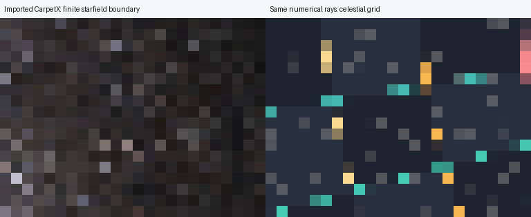

# CarpetX Phase 1: numerical validation

Measured on 2026-10-31, Windows, Python 3.13, NumPy 2.5.4, SciPy 1.18.1.
The copied C++ reference was executed under Ubuntu/WSL, GCC 11.4, using its
existing release library. Its sources were inspected and left unmodified.
The production Python evaluator has no C++ or simulation runtime dependency.
The Python regression run was on Windows; the live C++ oracle ran on Linux/WSL.
A complete Python regression run under Ubuntu was not performed in this session.
Source/binary hashes, environment versions and all 51 native payload hash pairs
are saved in `validation/provenance.json`.

## Scope established

Implemented the GMDS v1 loader, optional native ADMBaseX BP/BP5 converter, all
five reference spatial interpolation modes, static nested rectangular ratio-2
AMR, linear ADM temporal interpolation, analytic interpolation derivatives and
3+1 reconstruction. A guarded DOP853 adapter steps the **existing generic
Hamiltonian RHS** through saved temporal slabs. Analytical providers and their
integration paths were not replaced.

The reference audit preceded implementation; see [ARCHITECTURE.md](ARCHITECTURE.md).
Important preserved details include same-level stencil unions, legacy upper-cell
clamping outside hierarchy mode, no cubic refinement fallback, geometric branch
selection, derivative-of-weight terms, one-sided temporal derivatives, native
sample validation, and explicit failures. Exact integer box-union subtraction
certifies required hierarchy stencils over faces, edges, corners and open strata.

Deliberate restrictions: fixed ordered patch geometry at every time; no dynamic
AMR; native importer only the inspected Cartesian ADMBaseX BP/BP5 arrangement;
at least two saved times; no implicit time extension. No disks or analytical
metric-specific optimizations run on imported metrics.

## Live C++ / Python comparisons

Results and portable golden arrays: `validation/cpp_parity.json`,
`synthetic_cpp_golden.npz`, `manufactured_trajectories.npz`, and
`real_cpp_parity.json` / `real_cpp_trajectories.npz`.

| Mode | Events | Valid / rejected | Largest inverse/derivative component difference |
|---|---:|---:|---:|
| Linear | 16 | 16 / 0 | 4.92e-16 |
| Cubic | 16 | 7 / 9 | 4.76e-16 |
| Planar C1 | 16 | 14 / 2 | 4.04e-16 |
| Box C1 | 16 | 16 / 0 | 4.44e-16 |
| Hierarchy C1 | 96 | 96 / 0 | 4.76e-16 |

All 160 acceptance/rejection decisions agree. Hierarchy probes include exact
and one-ULP boundary points, all axis faces, and selected corners. Required-level
sets agree where reported by the reference. This is sampled parity, not proof
for every possible patch partition or floating-point lattice.

Independent raw node reads are bitwise equal. A common **C++ Eulerian tetrad**
has Python orthonormality error 2.22e-16; past photon momenta agree within
1.39e-17. This intentionally avoids comparing the projects' different default
observers or photon time orientations.

A manufactured trajectory crosses three refinement levels and a temporal knot.
With identical initial canonical state, Python rtol/atol=1e-11/1e-13 and C++
1e-12/1e-14, maximum matched-affine event and momentum component differences are
3.65e-10 and 7.38e-10. Python's normalized null maximum is 3.42e-10. Both end at
their prescribed affine limit (Python unresolved / C++ lambda_limit), rather
than falsely escaping.

For the genuine evolved three-level CarpetX dataset, 12 metric/derivative probes
agree within **2.53e-15**. A common-state escaping trajectory agrees within:

| Quantity | Difference |
|---|---:|
| Matched-affine event components | 1.25e-10 |
| Matched-affine momentum components | 2.28e-10 |
| Independently located finite-boundary endpoint | 1.44e-10 |
| Finite-boundary sky direction | 1.40e-11 radians |

Both identify the explicit finite background sphere. Python uses DOP853 dense
event roots; C++ uses DP5(4) and reintegrates event roots. The acceptance limits
used here are 2e-12 for metric/derivative components, 2e-8 for endpoint/state
components and 2e-9 radians for the finite direction. Observed errors are well
below these limits; no established physical tolerances were relaxed.

## Native file conversion

`openpmd-api 0.17.1.post4` / binding 0.17.1 was used with ADIOS2 enabled.
The six raw payloads from the independent three-time/two-level native fixture
are byte-for-byte equal to the C++ converter's saved files. The genuine native
17-time/three-level BP5 series produces **51 of 51 byte-identical payloads**;
see `native_payload_parity.json`. Cartesian origins, spacing, centering and
ordered geometry also match. This tests actual native I/O, not only synthetic
GMDS serialization. Source `unitSI` metadata is retained as provenance without
converting geometrized code coordinates or altering the physical ADM shifts.

## Analytical spatial and temporal studies

Uniform local grids sample the exact **outgoing** Schwarzschild and Kerr
(a*=0.5) providers. This avoids the C++ analytical provider's different ingoing
chart. Twenty-four fixed probe events measure RMS component error:

| Metric | h | Inverse metric RMS | Spatial derivative RMS |
|---|---:|---:|---:|
| Schwarzschild | 1 | 2.25e-5 | 5.71e-5 |
| Schwarzschild | 0.5 | 2.32e-6 | 1.46e-5 |
| Schwarzschild | 0.25 | 2.70e-7 | 3.72e-6 |
| Kerr 0.5 | 1 | 2.29e-5 | 5.81e-5 |
| Kerr 0.5 | 0.5 | 2.36e-6 | 1.49e-5 |
| Kerr 0.5 | 0.25 | 2.75e-7 | 3.77e-6 |

Observed value orders are 3.10–3.28; derivative orders 1.96–1.98, consistent
with the reference's centered Hermite cubic. Tight-tolerance trajectories use
the same local viewing direction, with a separately normalized null initial
momentum in each metric. Maximum event errors at affine length 2 decrease:
Schwarzschild 3.24e-4 → 2.84e-5 → 4.95e-6; Kerr 3.34e-4 → 4.62e-5 → 7.21e-6.
Camera interpolation error is included and recorded separately. Affine-limited
study trajectories remain explicitly unresolved; these are not failed captures.
See `validation/analytic_convergence.json`.

Two-level analytical AMR trajectories cross the actual blending region. Halving
the coarse spacing decreases maximum event error from 3.31e-3 to 2.15e-4 for
Schwarzschild, and 3.41e-3 to 2.81e-4 for Kerr. Both levels are used; maximum
normalized null residual is below 4.33e-8. These two measurements demonstrate
convergence but do not establish a universal AMR order. See
`validation/analytic_amr_trajectories.json`.

An **exact constant-velocity isolated boosted Schwarzschild** control samples
three time cadences at fixed spatial resolution. Probes lie at spatial nodes
to isolate temporal interpolation error. Cadences 1, 0.5, 0.25 give inverse RMS
4.92e-6, 1.23e-6, 3.07e-7 and time-derivative RMS 1.54e-5, 7.72e-6, 3.86e-6:
orders 2.000 and 0.998–0.999. This is an exact boosted-hole control, not the
approximate orbiting binary. See `validation/boosted_temporal_convergence.json`.

An independent flat, spatially uniform time-varying lapse test integrates
forward and backward across multiple knots at ordinary and 1e-9-scaled times.
It retains the reference's **1e-14 null criterion** and exact integrated affine
duration. Only time is snapped at roundoff-sized knot landings; photon momentum
is never projected or renormalized during integration.

## Subpixel analytical shadow checks

Synthetic cell-centered cubes avoid sampling the analytical singularity; no
singular field is filled or extrapolated. Static observer at (12,0,0), horizontal
FOV 60°, nominal projection 96×72. Numerical rays are bisected along **one
horizontal image-plane direction**, not measured from a PNG. Reference radii
are 35.77708764 pixels for Schwarzschild and 43.39726422 for Kerr a*=0.5, using
the existing finite-observer analytical shadow curve. Explicit absorbers of
Euclidean radius 1.99 / 1.7 lie strictly inside the respective known horizons;
the background detector R=14 is inside the data cube.

| Model | h | Numerical minus analytical radius, pixels |
|---|---:|---:|
| Schwarzschild | 1 | -0.181641 |
| Schwarzschild | 0.5 | -0.017578 |
| Kerr 0.5 | 1 | -0.146484 |
| Kerr 0.5 | 0.5 | -0.017578 |

Each final bracket is 0.01171875 pixels wide (midpoint uncertainty ±0.005859375).
All 40 rays classify as capture or escape; maximum null residual 8.11e-6 remains
below the unchanged 1e-5 threshold. This demonstrates resolution convergence
on the sampled boundary direction, **not full-curve or universal subpixel
accuracy**. Grid interpolation, bracket error and ODE error are distinct.
See `validation/shadow_boundary_convergence.json` for every classification.

## Real-data boundary and ODE convergence

The same outward ray from t=4, (6.5,0.23,0.17) is traced to R=7.5,8,8.5,9 at
rtol=1e-8,1e-10,1e-12, atol=rtol/100. All 12 escape to the explicitly requested
finite sphere. Against the tightest run at each radius, direction errors decrease
from 1.51–1.80e-8 to 2.76–3.48e-11 radians. Null maxima decrease from 3.51e-7
to about 1.62e-10. Tight-run direction changes between successive radii are
4.94e-4, 1.70e-4, 1.19e-5 radians.

These measurements separate ODE convergence from boundary dependence. The last
direction change is still measurable; **convergence to an asymptotic sky is not
established** within this short evolved dataset. No vacuum matching or infinity
interpretation is claimed. See `validation/real_domain_convergence.json`.

## Demonstration, performance and regression status

The genuine CarpetX preview uses 24×18 rays, camera t=4, FOV 40°, explicit R=8
direction sphere, no capture surface. **432 escape, zero captured, zero
unresolved**, max normalized null residual 1.42e-7. Both backgrounds are shaded
from the same `rays.npz`. The atlas is nearest-neighbor magnification, not extra
angular resolution. Runtime 344.9 s, two workers, 458,880 SciPy-reported RK evaluations,
26,548 accepted steps. This is a small imported-data functionality test, not a
physical shadow measurement or controlled performance benchmark.

The preview was saved before RHS accounting was extended to include manual
one-sided endpoint refreshes (one per accepted step in this successful run).
Current code counts those too: 485,428 total RHS calls for the same saved path
workload; no ray is retraced or altered by this accounting correction.

Warm metric throughput for 500 nonidentical three-level lookups: **753/s**;
first lookup including native pair validation: 0.0515 s. Two mapped snapshots
account for 17,249,760 bytes; a warmed serialized provider is only 16,936 bytes.
These are logical mapped bytes, not peak resident memory. One-off timings depend
on file cache and concurrent workloads. See `validation/performance.json`.
An additional 500-lookup cProfile sample assigns 0.818 of 0.940 s to ADM
evaluation, including 0.457 s in interpolation, 0.195 s in field validation and
0.164 s in node gathering (nested cumulative times must not be added).
See `validation/metric_profile.json`; no acceleration framework was introduced.

A 12-ray real-data serial/spawn check took 18.58 / 18.73 s (0.992× speedup).
**Every saved numerical array is exactly equal**, including statuses, directions,
null residuals and diagnostics. This tiny grid has only one batch task and
significant process/validation overhead; it is not evidence against larger-scale
parallelism or an optimal worker-count study. Correction from the optimization
audit: the scheduler batches 64 rays, so this 12-ray check used one actual child
despite requesting two; it was a spawn-equivalence check, not two-core scaling.
The optimization phase adds explicitly verified two-process batch measurements.
Synthetic supersampled serial/spawn
equality is also tested. See `validation/parallel_performance.json`.

The initial full regression suite passed **246 tests in 413.03 s**. The expanded
focused suite passed **17 tests in 18.73 s**, including six tests added after
the first full run. The **final complete suite passed all 252 tests in 418.15 s**
(6 min 58 s), including existing Schwarzschild, Kerr, Carter, disk and binary
regressions. The log is saved in `validation/test_results.txt`. No pre-existing
thresholds were weakened. The main configuration-driven CLI also passed a
2×2 real-data smoke test: four escapes, no unresolved rays.

## Limits and next steps

- Cross-language parity is established on the supplied fixtures and sampled
  events/trajectories; arbitrary CarpetX exports still require metadata checks
  and dataset-specific convergence studies.
- Python/NumPy is substantially allocation-heavy: same-level node gathering,
  64-node interpolation, two endpoint evaluations, native validation and RK
  stage counts dominate. No C++ throughput ratio or peak-memory result was
  measured; process-inclusive oracle calls would not be a fair kernel benchmark.
- Hierarchy certification uses integer coverage and directed floating-point
  endpoint bounds. NumPy extended precision differs between Windows and Linux;
  exotic near-roundoff decimal lattices need additional cross-platform reference
  cases. The actual inspected binary-spaced datasets and one-ULP tests pass.
- Ordinary cubic refinement/stencil boundaries can be discontinuous as in the
  reference. No smoothing, extrapolation, positivity clipping, or fallback was
  introduced to conceal this; choose a certified composite where appropriate.
- No event/apparent-horizon finder, physical exterior matching, radiation-frequency
  transport, disk support or dynamic AMR is supplied for imported spacetimes.
- More temporal slices, physically justified boundaries, broader shadow-curve
  sampling, decimal-lattice stress tests and isolated profiling are the next
  validation/optimization steps. Moving refinement needs a separate design.

Reproduction commands and Windows/Ubuntu instructions are in [README.md](README.md).
