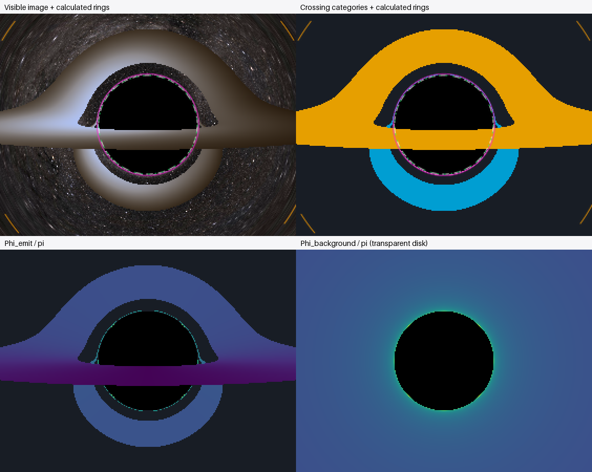

# Accumulated orbital angle: halo, branches and alignment rings

The upper halo is close to the calculated second celestial alignment ring at
this image's sampling, but it is **not the same constant-background-angle curve**.
The upper halo's emitting photons stop at approximately 1.85–1.97pi; its
hypothetical transparent continuation reaches approximately 2.00–2.28pi at
infinity. The branches share the recorded crossing-2 layer and join this range
progressively, but extend to substantially smaller accumulated angles.

## Outputs and provenance

Input: `output/disk-edge-on-blackbody-hires`, camera 60M, 60° horizontal FOV,
640×480, disk inclination 85°, annulus 6–20M. Neither the source nor earlier
disk-diagnostic products were overwritten. The physical renderer was not changed.

| Product | Full frame | Matching crop |
|---|---|---|
| Angle to opaque emission | [Phi_emit/pi](phi_emit.png) | [Crop](crops/phi_emit.png) |
| Transparent-disk background angle | [Phi_background/pi](phi_background.png) | [Crop](crops/phi_background.png) |
| Visible image plus alignment rings | [Overlay](visible_alignment_rings.png) | [Crop](crops/visible_alignment_rings.png) |
| Crossing categories plus alignment rings | [Overlay](crossing_alignment_rings.png) | [Crop](crops/crossing_alignment_rings.png) |



All crops use **x=[179,461), y=[134,346)** in the original camera image, enlarged
4× with nearest neighbor. The comparison atlas is 2×. This is magnification,
not new angular sampling. Plain `*_pixels.png` versions omit titles and legends;
decorated rasters start at (20,55). No alignment ring is displaced to make it
visually separable.

Numerical data: [orbital_angles.npz](orbital_angles.npz),
[cropped arrays](crops/orbital_angles.npz), [ring roots](alignment_rings.json),
[feature statistics](feature_statistics.json), [ODE audit](ode_validation.json)
and [metadata](metadata.json). Archives contain both radians and radians/pi,
validity masks, source and continuation classifications, explicit hypothetical
versus visible-background masks, emission radial leg and geometry residuals.
No background angle is assigned to captured continuations.

## Definition and reconstruction

Phi=0 at the camera. The initial past-directed covector gives positive E=p_t,
L=x cross p_spatial. Let e0=x_camera/|x_camera| and
e1=(L/|L|) cross e0. Increasing Phi follows the backward ray in this plane,
with **dPhi/dlambda=|L|/r² >= 0**. It is never reduced modulo 2pi. This basis and
quantity differ from the disk's emission-azimuth basis.
Phi is also not the conventional scattering deflection angle: in the flat
limit an initially inward ray launched at angle alpha tends to Phi_bg=pi-alpha,
rather than zero, because it measures the sweep of position about the origin.

Here Cartesian outgoing Kerr–Schild coordinates are spherical Schwarzschild
r,theta,phi written as x=r(sin(theta)cos(phi),sin(theta)sin(phi),cos(theta)).
The metric's angular part is r²dOmega² and its time transformation outside the
horizon is t_KS=t_S-2M log(r/(2M)-1). Thus only time changes; an SO(3) rotation
of the conserved orbital plane into the equatorial plane makes the unwrapped
position-vector angle exactly the Schwarzschild angular coordinate. This is
not an assertion about Euclidean angles in arbitrary numerical Cartesian metrics.

The saved first-hit positions plus original camera reconstruct the relevant
orbit. Initial covectors are generated with the original camera tetrad and
projection; exact rotational groups reuse their conserved quantities just as
the renderer does. No angle is inferred from apparent radius, disk azimuth,
crossing ordinal or brightness. Pixel offsets identify equivalent initial
conditions, not an empirical deflection formula.

Escaping orbits use the existing validated `schwarzschild_orbit.orbit` and its
stable u=u_turn(1-s²) turning-point factorization. The partial inward phase is
the integral from the saved radius to the camera in this variable; the outward
phase adds camera-to-turn and turn-to-hit integrals, counting the turn once.
The actual saved unit position is checked against both unwrapped candidates.
Captured inward segments use the nonsingular radial integral of
b/sqrt(1-b²u²+2Mb²u³). A repeated spatial point can be ambiguous without hit
momentum; such cases are marked unavailable rather than chosen by crossing count.
There are **no ambiguous or invalid emission phases in this dataset**.

All 22,694 emitting rays receive Phi_emit. There are 7,256 inward and 15,438
outward emitting intersections. Of those rays, 20,984 have an escaping
transparent continuation; 1,710 would instead be captured and have no Phi_bg.
The other 279,180 escaping background rays also receive Phi_bg, giving 300,164
valid background angles in total. The finite ODE escape sphere is a numerical
boundary: background angles extend to **null infinity**, exactly as in the
celestial-grid renderer. An opaque disk photon physically stops at its first
hit; the continuation does not transmit radiation through that surface.

## Independently calculated alignment radii

The alignment condition is Phi_background=n*pi: the asymptotic source direction
is aligned with the camera–black-hole axis, alternating its two directions.
These are geometric background alignments, not an assumed disk-emission feature.

For a static observer at r0=60M, sin(alpha)=b*sqrt(1-2M/r0)/r0 and
R_pixel=[640/(2 tan(30°))] tan(alpha). The center is (319.5,239.5), with
554.256258422 pixels per unit tan(alpha). Each root is bracketed in b and solved
independently at quadrature tolerances 1e-8, 1e-10 and 1e-12. The shadow uses
b_crit=3sqrt(3)M independently of those roots.

| Boundary | b/M | Angular radius | Pixel radius | Pixels outside shadow |
|---|---:|---:|---:|---:|
| Critical shadow | 5.196152423 | 4.884474074° | 47.365231153 | 0 |
| Phi_bg=pi | 17.007744284 | 16.182512133° | 160.842895287 | 113.477664134 |
| Phi_bg=2pi | 5.342481473 | 5.022374448° | 48.709244851 | **1.344013699** |
| Phi_bg=3pi | 5.202135869 | 4.890112308° | 47.420171929 | **0.054940777** |
| Phi_bg=4pi | 5.196410151 | 4.884716932° | 47.367597615 | 0.002366462 |
| Phi_bg=5pi | 5.196163558 | 4.884484567° | 47.365333398 | 0.000102245 |

These use the actual finite camera distance and original projection, not a
rescaling from 400M. The 2pi separation was calculated, not assumed to be 1.4
pixels. Root radii change by at most 5.7e-14 pixels across the tested tolerances
at floating-point precision; the largest residual through 5pi is 4.45e-11 rad.
This agreement is not a claim that the image resolves subpixel structure.
The independent ODE comparisons below supply a separate check on the convention.

Overlays use white dashed shadow, orange dashed pi, magenta solid 2pi and green
dotted 3pi. The 3pi curve and shadow are effectively inseparable in the native
image. Orders 4 and 5 are tabulated rather than artificially spread apart.

## Feature measurements

The exact earlier feature masks are reused and filtered by their recorded
crossing category: upper halo and both branches select crossing 2, lower halo
selects crossing 3. The visual ROIs overlap, so their counts are not additive.
Values below are **minimum / median / maximum** of valid samples.

| Feature | N | Phi_emit/pi | Phi_bg/pi, transparent |
|---|---:|---|---|
| Upper halo, crossing 2 | 82 | 1.853265 / 1.958987 / 1.971965 | 2.000209 / 2.148098 / 2.282446 |
| Left branch, crossing 2 | 33 | 1.338914 / 1.666473 / 1.931683 | 1.523907 / 1.858677 / 2.198461 |
| Right branch, crossing 2 | 33 | 1.338914 / 1.666473 / 1.931683 | 1.523907 / 1.858677 / 2.198461 |
| Lower halo, crossing 3 | 50 | 2.027962 / 2.032792 / 2.054248 | 2.125817 / 2.189449 / 2.335267 |

All these selected continuations escape. Signed distance is R_pixel minus the
calculated boundary radius; negative means inside. Again: minimum / median /
maximum, in **native pixels**.

| Feature | From critical shadow | From 2pi alignment ring |
|---|---|---|
| Upper halo | +0.535708 / +0.827092 / +1.343084 | -0.808305 / -0.516922 / -0.000929 |
| Left branch | +0.702429 / +2.157491 / +7.155407 | -0.641584 / +0.813477 / +5.811393 |
| Right branch | +0.702429 / +2.157491 / +7.155407 | -0.641584 / +0.813477 / +5.811393 |
| Lower halo | +0.452130 / +0.723229 / +0.889302 | -0.891884 / -0.620785 / -0.454711 |

Some representative pixel centers, measured from the top-left image origin:

| (x,y) | Selected structure | Phi_emit/pi | Phi_bg/pi |
|---|---|---:|---:|
| (313,192) | Upper crown | 1.971965 | 2.259141 |
| (272,231) | Upper halo toward branch | 1.853265 | 2.125817 |
| (275,220), (364,220) | Mirrored branch samples toward halo | 1.931683 | 2.029378 |
| (270,237), (369,237) | Mid-branch | 1.666473 | 1.853219 |
| (268,242), (371,242) | Outward branch extension | 1.338914 | 1.667741 |
| (314,287) | Lower thin halo | 2.027962 | 2.335267 |
| (278,264) | Lower arc flank | 2.054248 | 2.148098 |

The JSON supplies individual positions, angles, boundary distances and all
available branch-row samples, not just these examples.

## What the measurements establish

1. **The upper halo is near the 2pi background ring at this sampling, mostly
   just inside it.** Its selected centers are 0.001–0.808 pixels inside, with
   median 0.517 pixels. A center passing within 0.000929 pixels is not evidence
   that the entire visible feature coincides with the analytic curve. Its
   measured Phi_bg varies substantially rather than remaining 2pi.
2. **Upper-halo photons reach the disk near, but before, 2pi.** Their median is
   1.959pi. The background continuation is a different quantity: its remaining
   angle after emission ranges from 0.091pi to 0.311pi in this ROI, median
   0.193pi. Substituting Phi_emit for Phi_bg would give the wrong ring comparison.
3. **Both branches have identical angle statistics under left/right reflection.**
   Their values are not all approximately 2pi: the extensions reach about
   1.339pi at emission, and sampled continuations lie on both sides of the 2pi
   ring radius. Brightness asymmetry from motion does not change this geometric
   reflection symmetry.
4. **Angle increases toward the shadow in the background geometry.** Phi_bg is
   monotone with image radius for these centered escaping rays. Phi_emit also
   depends on where the opaque surface is reached, so it is not universally a
   function of apparent radius alone. On the available branch rows, median
   Phi_emit increases progressively when following the branch from y=242
   toward y=220 and then the upper crown at y=192; it does so symmetrically on
   both sides. Individual sampled radii and angle gradients can show raster
   jitter where the image is thinner than a pixel.
5. **The lower crossing-3 halo has emission angles just above 2pi**, whereas the
   upper crossing-2 halo is just below it. Different crossing ordinals do not
   imply a difference of pi in these selected photon angles: their orbital
   planes meet the tilted disk at different phases. The lower halo's background
   continuation is also above 2pi, not automatically 3pi.
   The data do not establish the complete image-family topology linking upper
   and lower arcs through the region obscured by foreground disk emission.
6. **The apparent upper-halo/branch connection is consistent with one related
   lensed disk-image layer**, supported by matching crossing category and
   progressively varying reconstructed orbital angles. It does not establish
   a constant-angle alignment ring or a unique image-order taxonomy. The
   earlier upper thin structure had 26 separate eight-connected sampled pixel
   components, so continuous geometric connectivity between every pixel is not
   resolved. Crossing count alone is not used to establish winding or image
   order. Proximity alone does not identify a photon ring.

## Independent numerical validation

Normal map construction uses 28,772 conserved-orbit quadratures and no image
ODE reintegration (about 17 seconds here). The explicitly requested ODE audit
uses **15 representative directions at two accuracies: 30 integrations**, about
12 seconds. It follows the original Hamiltonian solver, with unchanged
production settings and a separate tighter validation run at rtol=1e-11,
atol=1e-13. It samples first through fourth emitting crossings, capture,
capture after earlier disk emission, escape and weak deflection.

Two independent measurements on each dense ODE trajectory are compared:
unwrapping its actual orbital-plane position angle, and integrating
|x cross dx/dlambda|/r² along the same dense solution. The maximum checked sample
increment was 0.193 rad, below pi/2, and the rate integral checks for lost turns.
For background rays the same existing analytic infinity tail is added.

Tight-run maximum errors:

| Comparison | Absolute maximum |
|---|---:|
| Partial radial quadrature versus ODE emission angle | 9.01e-10 rad |
| Total orbital quadrature versus ODE plus infinity tail | 8.99e-10 rad |
| Original saved-map emission angle versus tight ODE | 9.56e-8 rad |
| Original saved-map background angle versus tight ODE | 8.99e-10 rad |
| Original saved hit position versus tight ODE | 2.84e-6 M |

The larger saved-emission difference reflects the original stored trajectory's
finite numerical accuracy, not a modified physical model. Across the full
dataset the maximum angular mismatch of the conserved orbit and saved hit
position is 1.21e-7 rad. All hits pass the separate 5e-6 rad reconstruction
consistency check; this is a diagnostic rejection criterion, not a relaxation
of the geodesic solver's tolerances.

The final complete suite passed **106 tests in 99.77 seconds**. Added tests cover
weak-field straight-line limits, both radial legs and the turning point,
outward launches (including an outward ray with b=b_crit, which escapes),
nearly radial motion, captures and critical uncertainty,
spatial-branch ambiguity, accumulated phases beyond 2pi, first through fourth
opaque hits, quadrature tolerance convergence, independent ODE ring roots,
camera projection, transparent-continuation masking and crop/overlay positions.
Previous diagnostic and physical tests remain intact.

## Reproduction, limits and next steps

```text
python -m numerical_observatory.orbital_diagnostics --validate-ode
python -m pytest -q
```

Use the environment's `.venv/Scripts/python` on Windows or `.venv/bin/python`
on Ubuntu; the root README has full commands. Omit `--validate-ode` for ordinary
saved-data postprocessing. `--input`, `--features`, `--output`, `--crop` and
`--scale` select paths and presentation. `--no-features` generates maps without
the earlier ROI masks. No expensive denser image render was launched.

The maps currently require a centered coordinate-static Schwarzschild camera;
the optional diagnostic-window camera is supported. They need saved positions
and original camera metadata, not saved hit momenta. A branch ambiguity or
inconsistent position is reported unavailable rather than guessed; exactly
critical continuations are unresolved. Exactly radial angles are zero, with
no chosen unique orbital plane; small nonzero angular momentum is retained.
The audit API uses the existing ODE infrastructure for independent trajectories.

At 640×480, one-pixel-wide emission and a 0.055-pixel shadow/3pi separation limit
visual interpretation. Density 8–16 in a small targeted window is appropriate
for the halo and branch connection. Three new pixels across the 3pi separation
would need roughly 64 samples per original pixel width. The existing optional
zoom helper is serial without full-frame rotational reuse; start with a small
window, for example:

```text
python -m numerical_observatory.diagnostic_zoom --input output/disk-edge-on-blackbody-hires --output output/branch-new-rays --crop 264 220 280 244 --density 8
```

That explicit command would launch 24,576 new rays at the same camera geometry
and numerical settings; it was **not run**. Detailed disk-hit/miss boundary
classification and any resulting image-order assignment remain separate work.
